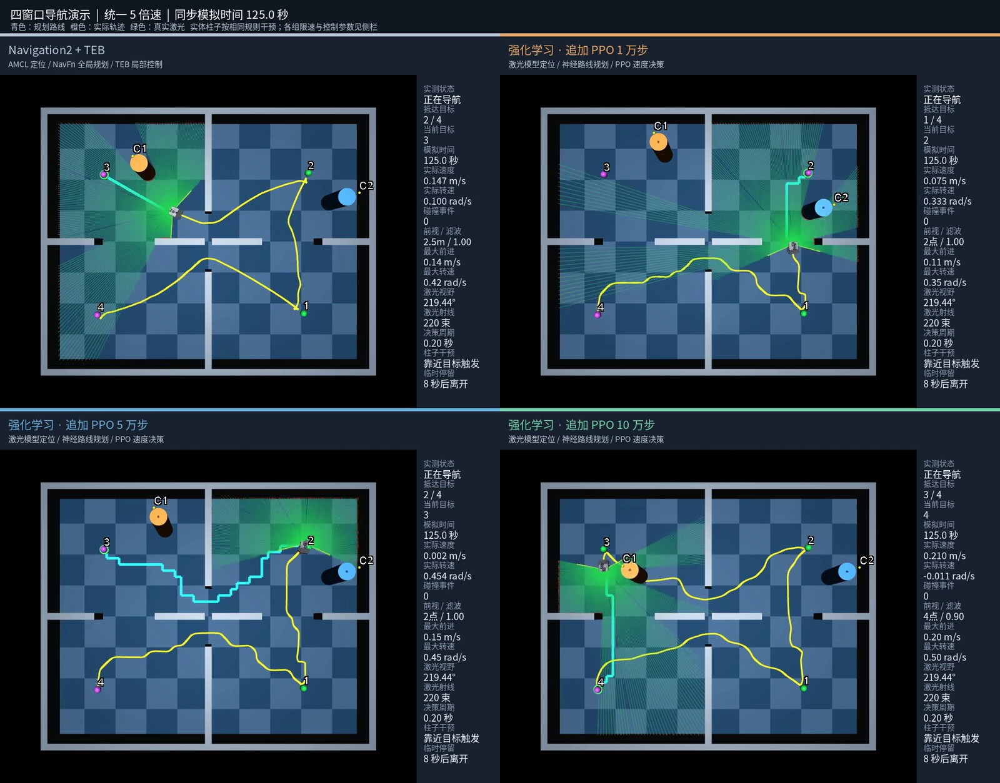

# AGV 学习导航与 MuJoCo 仿真

已知地图、部分视野激光与动态实体障碍下的四轮差速机器人导航。当前系统由学习定位、神经路线规划和 PPO 速度决策三个模型配合；地图/激光融合、路线切换确认和运动约束仍由程序处理。机器人导航运行时不使用 AMCL/A*；传统对照另使用实际 Nav2 AMCL、NavFn 与 TEB。

此目录是独立整理副本。原 training、agv、base_controller 和训练历史没有迁移、删除或改写。agv 子目录仅含离线仿真需要的 URDF、网格、雷达与机械臂配置，不是完整实车 ROS 工作区。

## 录制演示

[](docs/media/navigation-four-window.mp4?raw=true)

**[观看 / 下载完整视频](docs/media/navigation-four-window.mp4?raw=true)** · 约 8.7 MB · 82 秒 · 1600 × 1254 · 25 fps · H.264 MP4

左上为 Navigation2 + TEB，右上为追加 PPO 1 万步，左下为 5 万步，右下为 10 万步。画面包含规划路线、实际轨迹、部分视野激光扫描和实体柱子干预；统一 5 倍速，片尾汇总用时与路程，并介绍两种导航方式的优劣势。

本视频展示不同限速与控制参数下的表现；10 万步组完成更快，TEB 路程更短。模型权重未因录制而改变，实时测试命令仍运行原始模型配置。

## 安装（Ubuntu 22.04 / Python 3.10）

```bash
sudo apt-get install python3-venv build-essential libglfw3-dev libgl1 libosmesa6
bash scripts/setup_cpu.bash
source training/activate.bash
```

纯模型 MuJoCo 测试不要求 ROS。GPU 训练请按服务器 CUDA 环境安装相容的 PyTorch 构建，再安装 training/requirements.txt；CPU 安装脚本不会配置 CUDA。

## 原始 10 万步模型实时测试

所有命令从本仓库根目录执行。

```bash
source training/activate.bash
MUJOCO_GL=glfw python training/preview_live_navigation.py \
  --policy training/runs/remote_room_100k/policy_100000.zip \
  --components training/runs/remote_room_100k --max-leg-steps 1800
```

双击柱子后按住右键拖动，松开取消选中；左键旋转、滚轮缩放；空格暂停，R 重新开始。使用原始策略，无视频演示额外调参。激光范围 −108.38° 至 +111.06°（219.44°），220 束；两根实体柱子、四个目标点、机械臂离线归位姿态与原案例一致。

## 模型和训练

- training/runs/remote_room_100k/localizer.pt：学习定位网络。
- training/runs/remote_room_100k/router.pt：神经路线网络。
- policy_10000.zip / policy_50000.zip / policy_100000.zip：有预训练基础的追加 PPO 检查点，权重按原文件保留。
- training/runs/full_model_navigation_v3/：原续训父模型、定位/规划网络和离线动作样本，供复现原并行续训。

定位与路线网络的训练入口：training/train_neural_components.py；PPO 并行续训入口：training/remote/train_parallel.py。原 10 万步实验固定定位与规划权重，只续训 PPO，随机起点、朝向和目标顺序，主要使用既有房间布局。

```bash
# 生成学习定位/规划的数据地图，再独立训练网络
python training/generate_navigation_dataset.py
python training/train_neural_components.py --output training/runs/new_components

# 从保留的 v3 父模型开始新的 PPO 续训，CPU 示例
python training/remote/train_parallel.py --device cpu --envs 4 \
  --steps 100000 --output training/runs/new_continued_ppo
```

历史脚本默认引用其他旧检查点时，需要自行训练或从原目录另取，整理版没有打包所有历史结果。

## 自动干预评估与参数演示

```bash
# 原统一限速的模型评估
python training/navigation_comparison.py \
  --policy training/runs/remote_room_100k/policy_100000.zip \
  --output training/runs/new_fair_100k --max-leg-steps 1800

# 视频调参配置：与原始模型测试分开
python training/navigation_parameter_demo.py --preset ppo_100k \
  --output training/runs/new_parameter_100k
```

实体柱子按靠近目标触发、停留约 8 秒后离开的规则干预。录制脚本及压缩后的四窗口演示视频已保留；原录制轨迹未打包，重新录制需先生成其所需的四组轨迹。不同参数演示不能用来证明训练步数或算法的公平优劣。保留的实测数据见 docs/results/。

## 可选传统 Nav2 + TEB 对照

需要 ROS 2 Humble、Nav2、colcon、g2o 与 costmap_converter/TEB 构建依赖；第三方源码保留在 training/teb_ws/src/，构建产物需在目标机器重新生成。原桥接方式与配置见 docs/NATIVE_NAVIGATION_COMPARISON.md。这部分不属于纯模型启动依赖，未在没有 ROS 的机器上验证。

## 适用范围

目前是仿真导航原型，底盘采用平面力驱动跟踪速度，不是已标定的完整轮胎/电机模型。没有实车验证，也未证明跨任意地图的成功率。旧版历史说明见 docs/LEGACY_TRAINING_README.md，以本 README 的当前入口为准。

整理清单见 docs/EXPORT_MANIFEST.json；验证结果见 docs/VALIDATION.json。上传前检查第三方许可说明 THIRD_PARTY_NOTICES.md；本副本没有替作者新增开源授权。
