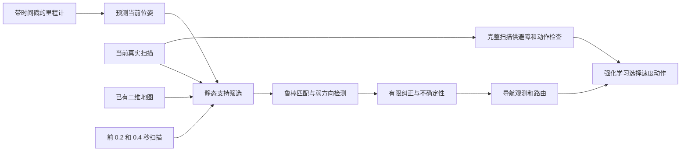

# AGV 定位优化：实现方式、证据与验证计划

更新日期：2026-10-15。文档分支：`docs/localization-validation-20261015`。

**本轮定位改善来自配套几何算法和配置，定位网络没有重新训练。固定输入回放已有改善，但整机导航、实车绝对精度和未知环境建图尚未验收。**

本分支基于已发布的 `models/best-2026-10-14`，增加本说明和约 25 KB 的证据快照。最新实验位于本地 `fix/localization-mapping-20261015` 工作区，含未提交改动；本次文档提交没有包含这些实验源码、候选权重、原始实车录制或完整传感器缓存。远程分支中的历史模型仍是原归档版本，不能将本文当作新版可执行模型包。

## 1. 要解决的实际问题

实车已有二维地图，但新增障碍物未入图；雷达有约 6%～12% 无效束和连续缺失。若定位把新障碍误当成原地图墙体，机器人没有走那么远，估计位置却会缓慢偏移。长墙、平行走廊和空旷区域又可能缺少某些方向的定位信息。

优化目标是：有可信静态几何时纠正里程计；证据不足时保留里程计预测并报告不确定性；新障碍继续参与避障，但不强迫地图定位去匹配它。这里需要同时处理“位置估计是否更准”和“能否识别当前估计不可靠”。

## 2. 当前定位是怎样计算的



### 2.1 先由里程计预测，再考虑地图纠正

用相邻时刻的里程计增量更新地图坐标中的位置与航向；不把 `odom` 坐标直接当作 `map` 坐标。麦轮反馈中的侧向位移也可以进入估计，即使当前策略动作不允许横移。

预测本身不保证准确。实车录制配置是**指令来源的平移＋EKF 融合 IMU 转向**，不能称为完全由编码器测得的轮子位移。录制中虽已有轮反馈和 `/wheel/odom`，本轮未切换实车输入来源，也没有改固件。后续要分别验证这些输入的误差。

### 2.2 筛选与已知静态地图一致的回波

定位从原 220 束中选取 60 束。将有限、有效距离的回波端点按预测位姿投到地图，检查是否在已知区域、是否接近地图中的静态表面。偏离太远或落在未知区域的端点不作为静态纠正证据。

端点距离门限为 `min(0.35 m, 0.18 m + 0.02 × 回波距离)`；这是当前实验配置，不是已测得的传感器误差界。剩余点采用 Huber 鲁棒损失，降低异常端点的影响。

**筛选仅作用于定位。原扫描不被删改，新增障碍仍供避障、制动和动作可行性检查使用。** 此方法没有完成物体语义识别：新增障碍若恰好接近旧墙，仍可能通过筛选，需用专项测试检验。

### 2.3 只纠正有几何约束的方向

对扫描与地图距离场的局部匹配构造几何矩阵，检查其特征值。墙面法向可能有充分约束，而沿长墙的位移可能不可辨认。只在较强方向使用扫描纠正，较弱方向继续依赖里程计。

稀疏版本将支持点下限由 12 降到 3，同时保留静态支持比例、弱方向投影和按支持数量缩放的信息量。支持点可包含通过复核的时序点，不能理解为任意 3 个当前回波都足以可靠定位。单独降低门槛的实验曾使稀疏场景变差，因此不采用该简化方案。

### 2.4 在物理时间上融合短时静态回波

使用当前扫描、前 0.2 秒和前 0.4 秒的静态支持，按里程计变换到当前车体坐标。历史采样容差为 0.05 秒，而不是简单拼接最近三帧。

历史点必须再次满足当前扫描中有有限、距离一致的回波，以及静态地图一致性检查。整帧缺失、新障碍遮挡或当前射线与旧点矛盾时，不恢复旧点。三帧信息取平均，避免将高度相关的历史扫描当作三次独立测量，造成过度自信。

### 2.5 限制纠正，并单独维护弱几何误差预算

每次地图纠正有距离、角度和变化速率上限。另在缺少观测约束的方向按经过时间、行驶距离与转角累计里程计误差预算，避免大量短步积分把系统性偏差“平均掉”。

这个预算**不改变位置估计**，只提高不确定性下限，使系统更谨慎。预算与协方差尚未用实车独立参考位姿标定，不能把输出标准差直接当成真实误差上界。预算变大引发更多停车，也不等于导航能力改善。

### 2.6 用 C++ 加速局部优化

定位核使用预编译 C++ 共享库，Python 仍负责数据筛选和时序处理。固定 3,221 帧中，Python/C++ 位姿最大数值差约 `1.47e-14`，用于检验数学实现一致性。

当前共享库是 x86_64，Jetson Orin Nano 为 ARM 平台，需要重新编译、更新文件哈希并复测；桌面耗时不能作为 Orin 性能结论。

## 3. “算法、配置、模型”的区别

| 部分 | 本轮作用 | 是否靠本轮 PPO 更新 |
|---|---|---|
| 几何定位程序与原生内核 | 里程计预测、静态匹配、时序支持、弱方向处理 | 否 |
| 定位与不确定性配置 | 规定支持门限、时间窗口、纠正限幅、误差预算 | 否；仍需标定 |
| `localizer.pt` | 候选包保留的原定位权重；几何定位模式不依赖其神经打分 | 未更新 |
| `router.pt` | 路由网络 | 本轮恢复 PPO 中冻结 |
| 导航/恢复 actor、critic | 学习选择局部速度、转向、等待或恢复 | 独立小规模试验有更新，但未通过验收 |
| 方向停靠 actor | 支持接近终点及位置＋航向目标 | 后续恢复试验中保留原版 |

因此，单独复制旧的或新的 `localizer.pt`，不会获得本文的几何定位改善。将来交付需要完整的运行代码、配置合同、平台匹配的内核、导航权重及哈希清单，并核对 ROS 输入与时间语义。

## 4. 当前配置与本地实现位置

配置快照可直接查看：[定位合同](evidence/temporal_localization_contract.json)、[弱几何预算](evidence/uncertainty_contract.json)、[硬件](evidence/temporal_hardware.json)、[候选文件清单](evidence/temporal_manifest.json)。这些 JSON 是说明用快照，**不构成可运行部署包**。

| 参数 | 当前值/含义 |
|---|---|
| 方法合同 | `fast_static_tracking_temporal_native_v1` |
| 初始状态 | 必须给定地图中的初始位置和航向 |
| 全局重定位 | `false`，不支持任意位置搬车后自动找回 |
| 定位束数 / 优化迭代 | 60 / 4 |
| 最少支持点 / 静态支持比例 | 3 / 0.35；另有几何有效性检查 |
| 历史时刻 | 当前、−0.2 s、−0.4 s |
| 历史点与当前回波距离容差 | 0.10 m |
| 总纠正上限 | 0.12 m、0.15 rad；还受时间速率上限约束 |
| 纠正速率上限 | 0.30 m/s、0.50 rad/s |
| 误差预算标定 | `calibrated=false` |

本地实验工作区：`/home/ubuntu/rl_learn/.real-adaptation-20261014`。下列实现尚未随本次文档提交上传，源码哈希记录于 [PROVENANCE.json](evidence/PROVENANCE.json)：

| 本地相对路径 | 内容 |
|---|---|
| `training/neural_navigation/fast_static_localizer.py` | 静态支持、物理时间融合、弱方向和纠正限幅 |
| `training/neural_navigation/static_tracking_kernel.cpp` | 原生优化核 |
| `training/neural_navigation/weak_geometry_uncertainty.py` | 未观测方向的累计误差预算 |
| `training/experiments/benchmark_sparse_localization.py` | 冻结传感器对照和 Python/C++ 一致性 |
| `training/experiments/benchmark_constraint_uncertainty.py` | 位姿不变与不确定性变化检查 |
| `training/experiments/replay_odom_adaptation.py` | 实车固定输入回放 |

## 5. 已有什么证据

### 5.1 冻结仿真传感器回放

相同 28 条轨迹，其中 22 条归档验证轨迹按帧汇总。长轨迹已用于诊断，属于开发回归，不能再称为未见地图测试。人为里程计偏差是压力条件，不是实车标定结果。

| 方法 | 汇总位置误差 P95 | 定位平均 CPU/帧 |
|---|---:|---:|
| 旧 v5 定位 | 43.42 cm | 2.93 ms |
| 上一轮单帧轻量定位 | 48.48 cm | 1.46 ms |
| 当前时序静态匹配 | **18.51 cm** | **2.93 ms** |
| 所测 AMCL 标准配置 | 29.37 cm | 3.66 ms |
| 所测 AMCL 低粒子配置 | 54.99 cm | 1.12 ms |

这是帧合并后的 P95，不是各场景 P95 的平均数，也不是实车误差。AMCL 为已安装 Nav2 1.1.19 原生库、全向运动模型、同样 60 束，标准配置 300～1000 粒子、低粒子配置 100～300 粒子并带运动触发，三个种子；未穷尽调参。CPU 不含 ROS、IO 或限额等待，不涵盖全局多假设定位。不能据此泛称比 AMCL 更准、更省算力。

| 约 12 m 长程回归 | 上轮轻量 P95 | 当前 P95 |
|---|---:|---:|
| 单面长墙 | 40.87 cm | 12.36 cm |
| 平行走廊 | 49.95 cm | 20.33 cm |
| 稀疏不对称结构 | 49.12 cm | 30.54 cm |
| 有特征区域进入空旷区域 | 37.70 cm | 18.01 cm |

稀疏场景最终位置误差仍约 **34.5 cm**，不满足精细停车或窄道通行要求。相同几何换传感器种子也有改善，但不能代替新地图泛化测试。详见 [定位结果快照](evidence/localization_results.json)。

### 5.2 原实车录制回放

共 1,516 帧，回放使用同一份雷达和里程计；**没有独立绝对位姿参考**。

| 录制片段 | 原记录估计位移 | 当前回放估计位移 | 输入里程计位移 |
|---|---:|---:|---:|
| mission 13 | 0.735 m | 0.055 m | 0.055 m |
| mission 19 | 1.347 m | 0.025 m | 0.025 m |

两段候选没有接受地图纠正，位移主要跟随里程计，说明抑制了缺乏静态证据的地图拉偏。**0.055 m 和 0.025 m 是估计位移，不是定位误差，更不能表述为已实现 5.5 cm 或 2.5 cm 精度。** 里程计自身若漂移，这种回退也会漂移。[回放证据](evidence/recorded_replay.json)

### 5.3 不确定性与闭环导航

新增弱几何预算前后，28 条回放位姿最大变化为 0。稀疏场景“错误但仍被判可信”帧占比从 18.3% 变成 0，不确定帧却达到 87.5%。这是更保守的风险提示，不是误差归零，也没有证明概率校准正确。[不确定性证据](evidence/uncertainty_results.json)

12 个复用的开发任务中，时序定位候选为 10 次安全到达、2 次碰撞；再加入动态动作约束的组合候选为 11 次到达、1 次碰撞，方向停车任务均为 6/6。这个变化包含动态约束影响，不能全部归因于定位；也不是对最初实车 2k 模型的新完整对照。

后续两次独立追加 2,000 步 PPO 均仍为 11/12，且共同成功任务总路程分别增加 2.10% 和 8.78%，未通过开发效率门槛。**最新 PPO 没有证明修复剩余碰撞，也不是定位精度提升的来源。** [导航与训练结果](evidence/navigation_results.json)

## 6. 怎样验证这种方案是否可行

验证顺序为：输入核对 → 固定输入对照 → 独立实车精度测量 → 闭环导航回归 → 目标板耗时。每一步单独出结论，不能用上一层通过代替下一层。

### 6.1 先核对输入与坐标，排除数据问题

1. 保存地图图像＋YAML，记录分辨率、原点、未知区阈值及 SHA256；图像补齐不改变世界坐标，不将未知格改为空闲。
2. 检查 `map → odom → base_link → laser` 的方向、唯一发布者和雷达外参；确认地图纵轴与米制尺度一致。
3. 检查雷达角度、束数、时间戳、量程与缺失语义。真实上限 10 m，不能把 10～12 m 当成已观测空闲；保留连续缺失角度与持续时间。
4. 核对实际 `/odom` 来源，分别记录指令积分、轮速反馈、IMU 和融合结果。所有候选使用相同输入，不让一版读取更准确的隐藏反馈。
5. 核对扫描年龄、里程计插值/对齐和历史时间间隔；同一时间戳不能重复累积信息。重置 `/initialpose` 后清空历史和关联状态，并分段评分。

### 6.2 固定输入回放：隔离定位器影响

冻结相同地图、初始位姿、扫描、里程计与时间戳，分别运行旧定位、时序定位，以及“时序定位＋误差预算”。回放不改变原始输入和执行轨迹。

| 对照条件 | 检查内容 |
|---|---|
| 机器人静止，新增地图外障碍靠近/离开 | 估计是否被拉向新障碍，是否错误接受静态纠正 |
| 长墙、长走廊、对称区域、空旷区域 | 按可观测方向分别统计位置/航向误差及错误可信比例 |
| 零星丢点、连续扇区缺失、整帧中断与恢复 | 历史点会否在无当前证据时被错误使用，恢复后是否跳变 |
| 里程计比例误差、转弯偏置、受阻不动 | 是否把错误积分误当成可靠真值 |
| 正常静态墙角和丰富几何 | 是否因过滤过严丢掉有效纠正，损伤原有准确性 |

有独立参考时计算位置/航向 RMSE、P95/P99、最大误差、终点误差、按方向误差和恢复时间。无参考的历史 bag 只报告静止漂移、跳变量、纠正量、支持比例和连续性，**不报告绝对精度通过**。不确定性另外检查覆盖率和错误可信比例，不能只看标准差变大。

当前本机的复测示例，**仅适用于保留完整实验代码和缓存的本地工作区；在只克隆本远程文档分支的目录不可直接运行**：

```bash
cd /home/ubuntu/rl_learn/.real-adaptation-20261014
export PYTHONPATH=training
export OPENBLAS_NUM_THREADS=1 OMP_NUM_THREADS=1 MKL_NUM_THREADS=1

# 28 条冻结轨迹；独立新输出目录，软平均约 0.25 个 CPU 核。
nice -n 19 /home/ubuntu/rl_learn/rl_learn_agv/.venv/bin/python \
  -m experiments.benchmark_sparse_localization \
  --cache reports/localization_mapping_20261015/amcl_comparison/sensor_cache \
  --kernel models/localization_mapping_20261015/temporal_native_candidate/portable/localization_kernel.so \
  --temporal --cpu-cores .25 \
  --output /tmp/localization_temporal_recheck_20261015

# 原实车记录：固定输入，仅检查纠偏，不是闭环导航。
nice -n 19 /home/ubuntu/rl_learn/rl_learn_agv/.venv/bin/python \
  -m experiments.replay_odom_adaptation \
  --record /home/ubuntu/rl_learn/record_analysis_20261014/raw/20261014_193644_map_01test_953a9959 \
  --bundle models/localization_mapping_20261015/temporal_native_candidate/portable \
  --temporal-static --cpu-cores .25 \
  --output /tmp/localization_recorded_recheck_20261015
```

上面第二条运行 Python 参考定位，用于检查时序算法；不是 ARM 原生库性能测量。复测输出目录应使用新名称，避免覆盖结果；本次文档整理没有重新运行这些长实验。

### 6.3 实车影子对照：需要补录什么

先让候选仅计算位置，不发布驱动命令。用人工低速行驶或已验证的控制方式，在相同数据流上比较旧/新定位；不得让两个节点同时发布 `map→odom` 或控制底盘。

最低记录内容：

| 数据 | 用途 |
|---|---|
| `/scan`、雷达时间与外参 | 原始距离、缺失方向、有效性和数据年龄 |
| `/odom`、`/rl_navigation/odom_raw`、可用的轮速/轮里程计、`/imu` | 区分运动预测与真实执行误差 |
| `/tf`、`/tf_static`、地图 PGM＋YAML | 还原地图与传感器坐标 |
| `/initialpose`、`/goal_pose` | 区分人为重定位、目标位置与目标航向 |
| 实际发出的 `cmd_vel`、模型位置、候选位置、停止原因 | 分析定位变化是否影响控制；命令不能当成真实速度 |
| 版本、合同、模型/地图哈希、会话元数据 | 保证对照确实使用同一版本与条件 |
| 独立参考位置/航向及其时间、误差范围 | 判断绝对精度，而非仅看 RViz 是否对齐 |

话题名以实车 `ros2 topic list` 为准；`/map`、`/tf_static` 和会话元数据需核对持久化 QoS，录制后确认确实收到了消息。原始 bag 与地图应额外保存，不能只录屏。

推荐采集：原地 60 s、直行 3～5 m、左右转和方形闭环；静止时移动新障碍；长墙/走廊；进入空旷区再返回；允许的短时遮挡和正常恢复。每类先做至少 5 次，记录人工干预。人工重新设置位姿之后作为新段，不能把重置后误差清零记作自动恢复成功。

独立参考可使用经标定的外部相机/测量系统，或精度已知的地面检查点和车体位置、方向量测。只在终点人工量测时，只能证明检查点/终点精度；不能由此推算整条轨迹 P95。以另一套 SLAM 输出作参考时，明确它也有误差，且不能再据此独立证明优于同一算法。

### 6.4 闭环导航：确认定位改善没有损伤避障和停车

先以相同任务和保护参数配对评估旧/新系统。只有定位一项变化时用于定位因果对照；动作约束和 actor 改动另做实验。

必须覆盖正常直行、左右绕障、窄道及路口、长绕行、动态横穿/停走/反向、临时堵路、丢帧恢复、原地改变目标朝向、位置＋方向停靠。记录物理碰撞、人工干预、假到达、超时、真实行驶距离和耗时。共同成功任务才比较效率，不能把碰撞后提前结束当成更快、更短。

原 48 项历史回归与本轮 12 项开发集分别保留；开发集反复使用后不能称为最终测试。正式模型选择应另冻结至少 200 项未参与调参的测试任务，按地图来源隔离，先固定分桶、种子与评分规则。大批仿真测试也不能替代实车闭环。

### 6.5 建议验收门槛：待执行，不是当前成绩

下表为下一轮建议目标，必须在测试开始前固定。对参考精度不足或几何长期不可观测的场景单列，不通过删掉失败来达标。

| 层级 | 建议目标 |
|---|---|
| 已知地图常规工况 | 独立连续参考下位置 P95 ≤5 cm、航向 P95 ≤3°；逐场景报告，且无新增错误到达 |
| 新障碍干扰 | 静止时新增障碍不引发持续地图拉偏；在支持不足时明确退化，不能保持虚假高置信度 |
| 精细停靠 | 物理终点误差 ≤5 cm、航向误差 ≤5°，明确计入每次人工干预和超时 |
| 弱几何/暂时遮挡 | 给出漂移随时间/距离增长、可支持的最长退化时长和恢复时间；超出能力时安全停止，不声称无限无漂移 |
| 静态导航 / 动态导航 | 冻结测试集分别争取 ≥98% / ≥95% 安全到达；该批测试无碰撞、无假到达，不据此承诺所有环境零风险 |
| 配对能力保持 | 旧成功任务不得新增失败；开发效率门槛：共同成功总路程增幅 ≤2%、总耗时 ≤5%，单项增幅 ≤20% |
| 目标板实时性 | 测整链路 P95/P99、最大值和超期比例；P99 低于真实控制周期，并报告冷/热加载与内存；Orin 实测后再定发布预算 |

**5 cm 定位 P95 不等于窄道安全。** 车宽约 32.95 cm，通道只宽出 10 cm 时，理论单侧余量仅 5 cm；现有安全余量又占 4 cm。定位横向误差、地图误差、航向导致的车体包络和控制误差必须共同满足余量，不能拿放宽保护或缩小车体换通过。P95 也不是最坏误差上界。该类通道需专项量测和可行性判定。

已知地图跟踪与在线 SLAM 必须分别验收。后者另外检查地图变形、回环前后漂移、保存恢复和导航连续性；不能把已知地图回放成功当作边建图定位已通过。

## 7. 当前不具备的能力与下一步

- **搬车后任意位置自动重定位未实现。** 需要丢失检测、停车、全局多位置/航向假设搜索及连续验证；轮子不转时的搬运不一定触发里程计跳变。当前应手动设置可信 `/initialpose`，不能假定已有保护一定识别搬车。
- **完全无特征区域长期不漂移无法靠训练保证。** 里程计、IMU 和地图几何的可观测性仍是边界；开放地图不必封闭，但须实测可见结构是否提供足够约束。
- **在线建图定位尚未通过。** 已做过 SLAM Toolbox 与其他里程计的独立实验，仍有漂移、假到达等失败，不归入本文已证明的改善。
- **下一轮先补实车独立参考与输入标定，再校准不确定性。** 若新增障碍仍造成错误纠正，修改几何筛选；若是长程不可观测，先处理融合与重定位。只有证据指向网络/策略时，再针对组件训练，保留正常导航和方向停车回归。

速度决策仍由强化学习模型负责；此定位方案没有引入 Nav2 控制器或行为树接管。几何定位属于配套估计模块，不宜称为“所有定位能力均由强化学习学得”。

## 8. 如何核对本分支的证据文件

[证据清单](evidence/manifest.json)记录本文附带 JSON 的 SHA256；[来源记录](evidence/PROVENANCE.json)记录本地报告与实验源码哈希。下列命令只验证文档证据是否完整，不重新跑定位、训练或实车测试，可在本分支仓库根目录直接执行：

```bash
python3 - <<'PY'
import hashlib
import json
from pathlib import Path

root = Path('docs/localization/evidence')
manifest = json.loads((root / 'manifest.json').read_text())
for name, expected in manifest['files'].items():
    actual = hashlib.sha256((root / name).read_bytes()).hexdigest()
    if actual != expected:
        raise SystemExit(f'证据文件不一致: {name}')
print(f"{len(manifest['files'])} 个证据文件哈希一致；这不等于导航验收通过。")
PY
```

复测记录应保存：`问题假设 → 单项改动 → 数据划分与版本 → 定位/导航分场景结果 → 正常能力是否退化 → 保留或拒绝`。目前所有最新候选均为实验状态，原实车模型未因本次文档提交被替换。
