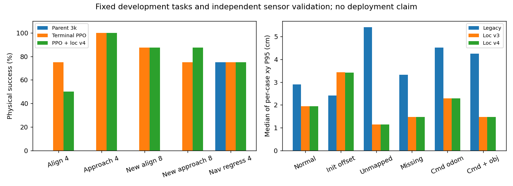

# 终点方向停靠 PPO 与里程计锚定定位：本轮结果

本轮完成一条保留链上的 **10,000 步终点 PPO**，并验证定位 v4。新产物单独保存，`deployment_approved=false`；下表只表示固定开发任务的物理结果，不能外推成实车成功率、未见地图泛化或全局最优路径。

## 导航物理对照

| 任务 | 上轮 3k | 本轮 PPO | PPO＋定位 v4 |
|---|---:|---:|---:|
| 旧方向对齐 | 0/4 | 3/4 | 2/4 |
| 旧接近后停靠 | 0/4 | 4/4 | 4/4 |
| 新增方向对齐 | 0/8 | 7/8 | 7/8 |
| 新增接近后停靠 | 0/8 | 6/8 | 7/8 |
| 旧位置导航回归 | 3/4 | 3/4 | 3/4 |

- 上轮 3k：3/28 成功，1 次碰撞、24 次超时、0 次假到达。失败任务：motion_profile_015, goal_pose_00, goal_pose_01, goal_pose_02, goal_pose_03, goal_pose_04, goal_pose_05, goal_pose_06, goal_pose_07, docking_dev_00, docking_dev_01, docking_dev_02, docking_dev_03, docking_dev_04, docking_dev_05, docking_dev_06, docking_dev_07, docking_dev_08, docking_dev_09, docking_dev_10, docking_dev_11, docking_dev_12, docking_dev_13, docking_dev_14, docking_dev_15.
- 本轮停靠 PPO：23/28 成功，1 次碰撞、4 次超时、0 次假到达。失败任务：motion_profile_015, goal_pose_00, docking_dev_02, docking_dev_08, docking_dev_15.
- PPO＋定位 v4：23/28 成功，1 次碰撞、4 次超时、0 次假到达。失败任务：motion_profile_015, goal_pose_00, goal_pose_03, docking_dev_02, docking_dev_08.



共 28 个任务：24 个方向任务＋4 个刻意包含旧失败的位置任务；三个版本合计 84 条结果。其中 **72 条本轮新运行，12 条上轮 3k 基线复用历史记录**。复用前核对任务参数、父模型 SHA256 和逐条轨迹散列；不能把复用数据算作新的独立重复实验。新增 16 个任务在 5 张既有训练地图上，含不同朝向、接近距离、额外丢点及两次整帧中断，属于开发测试，不是封存验收。

方向验收没有放宽：物理位置误差 <12 cm，方向误差 <0.15 rad（约 8.6°），实际速度 |vx|<0.03 m/s、|wz|<0.08 rad/s，并保持 0.4 s。四个旧位置任务沿用位置误差 <20 cm 的原判定，三个版本采用相同标准，不与方向任务混算。激光、里程计和估计位姿进入模型，MuJoCo 真值仅用于奖励、标签与评估。碰撞后末端误差可能来自执行碰撞前的最后决策帧，碰撞事件以物理运行器记录为准。

逐例数据见 [navigation_results.csv](navigation_results.csv)、[SUMMARY.json](SUMMARY.json)、[evaluation/RESULTS.json](evaluation/RESULTS.json)。[index.html](index.html) 显示物理真值与定位估计的配对回放，静态地图随案例切换；未包含动态物体动画。

## 本轮方法与实际试错

1. 保留上轮 303 维、12 动作导航演员；新增 112→64→64→12 的终点演员。目标方向、速度、上一动作、最新雷达与质量特征进入新演员，两个演员的全部速度选择都来自模型。
2. 64 条训练用参考驾驶轨迹中 57 条满足物理成功，共 1,112 个实际决策帧。近目标帧增加 8 份目标朝向反事实任务标签，得到 6,792 个教师标注帧；这些新增标签不是完成了更多真实轨迹。按原始 episode 划分验证，选取教师一致率 90.625% 的预热检查点；一致率不是导航成功率。
3. 首个独立试验保留 2.5k 检查点后停止：方向条件学得弱，预热闭环仅 1/8。该试验没有并入最终 10k。第二条保留链先训练 2.5k；发现原角度势能在静止或远离目标时可能形成错误激励，改成物理距离进展＋近目标角度进展，接着追加 2.5k。
4. 0.8 m 的接管范围导致接近过程提前停车。相同预热权重下改为 **估计目标距离 0.10 m 内接管**，原 8 项由 6/8 改善到 8/8；带 5k PPO 权重也为 8/8。随后再追加 5k，终点 PPO 保留链累计 10k。这个收益来自结构、任务条件、示范与 PPO 的组合；本轮没有证明单独增加 PPO 步数带来了多少额外收益。
5. PPO 使用采样动作、原概率及相同掩码更新，执行动作进入物理和历史。没有运行时参考控制器、Nav2 或行为树。原导航演员权重逐项完全一致；终点演员相对示范预热权重的 L2 变化为 0.330882。导出一致性和近目标方向敏感性见 [actor_diagnostics.json](actor_diagnostics.json)。

保留链是 2.5k＋2.5k＋5k。中断前额外未保存的 rollout 不计入保留步数；PPO 网络和 Adam 可继续训练，但物理回合和 RNG 重置，不能称为逐位续训。原导航模型本身的既有训练步数没有计入这 10k。

## 定位对照与边界

v4 保持里程计传播、静态表面支持、可观测方向约束和位置修正限幅，只将正常地图航向修正速率上限从 0.06 调到 0.15 rad/s。新物体回波只在定位匹配中筛选，仍供避障使用。定位网络和 router 网络没有经过本轮 PPO 更新；这部分改善是工程调整。

先在 24 条配对物理轨迹做速率消融，再换随机种子验证另 24 条。以下为每类 4 条轨迹各自 P95 的中位数，包含启动阶段，不是全部帧混合后的总体 P95：

| 条件（新随机种子，每类 4 条） | 原定位平移 cm | v3 平移 cm | v4 平移 cm | 原航向 ° | v3 航向 ° | v4 航向 ° |
|---|---:|---:|---:|---:|---:|---:|
| normal_feedback | 2.89 | 1.94 | 1.94 | 0.84 | 0.20 | 0.20 |
| small_initial_offset | 2.41 | 3.43 | 3.42 | 0.42 | 1.64 | 1.56 |
| unmapped_obstacle | 5.41 | 1.15 | 1.15 | 0.69 | 0.23 | 0.23 |
| missing_sector | 3.33 | 1.47 | 1.47 | 0.73 | 0.25 | 0.25 |
| command_odometry | 4.52 | 2.29 | 2.29 | 0.89 | 0.61 | 0.61 |
| command_and_unmapped | 4.24 | 1.47 | 1.48 | 0.79 | 3.36 | 1.11 |

“指令积分＋未入图障碍”航向：第一组 v3 3.53°→v4 0.95°；换种子后 3.36°→1.11°。但原定位在这两组的航向仍更低；初始偏差场景的启动 P95 也仍有退步。不能据此称所有定位条件均优于原版。完整三方数值见 [localization_ablation.json](localization_ablation.json)、[localization_validation.json](localization_validation.json)。

真实录制回放 1,516 帧中，代次 13 的候选估计相对位移 0.0548 m，代次 19 为 0.0248 m，均等于输入里程计，未施加地图修正；原录制为 0.7353 m、1.3466 m。**这些是位移，不是有真值的定位误差**，也不是闭环实车成功。见 [real_record_replay.json](real_record_replay.json)。指令积分仍不等于真实轮速，完全无结构区不能长期保证绝对位置。

## 资源、产物与下一步

单 Torch/BLAS 线程、nice 19，训练单进程平均约 0.5 CPU 核；记录的各阶段时长、峰值内存、PPO 统计在 SUMMARY 和模型 progress 中。评估另使用 0.25–0.5 CPU 核软限额。总磁盘增量保留在独立目录，没有删除用户文件。23 项功能检查通过，涵盖策略概率/掩码、冻结分支、导出、物理进展激励、目标条件、时间尺度和适配器合同。

模型在 `models/docking_candidate_20261014/policy.zip`；`portable` 保留原定位，`portable_v4_localization` 为组合实验。都需 `experiments.docking_navigation.DockingRuntime` 和对应 303 维合同，不能单独覆盖旧 actor。源码、训练链、预热数据和评估证据可追溯。端到端耗时见逐例结果；它是本机离线运行时，尚不是 Jetson Orin Nano 或 ROS 实车时序实测。

下一步根据组合版逐例失败决定保留哪一个定位合同，再做初始设置位姿后的稳定性、现有轮速/IMU/时间戳标定和真实 10 Hz 丢点/延迟影子测试。旧横穿碰撞、窄道全量回归、长距离/最短路径及目标硬件预算需专项验收；原发布 48 项没有在本轮全部重跑，不借用其 46/48 来包装新模型。

## 公开方法依据与复现

参考 [Nav2 RPP 的接近目标减速](https://docs.nav2.org/rolling/configuration_and_development/configuration_guide/controller_plugins/configuring_regulated_pp/)、[Rotation Shim 在位置容差内对齐目标方向](https://docs.nav2.org/rolling/configuration_and_development/configuration_guide/controller_plugins/configuring_rotation_shim_controller/)、[StoppedGoalChecker 检查目标位姿与停车](https://docs.nav2.org/rolling/configuration_and_development/configuration_guide/core_servers/controller_server/controller_server_plugins/stopped_goal_checker/)。公开工程提供设计依据，本项目的效果由上述测试判断。

```sh
PYTHONPATH=training OPENBLAS_NUM_THREADS=1 OMP_NUM_THREADS=1 MKL_NUM_THREADS=1 \
nice -n19 /home/ubuntu/rl_learn/rl_learn_agv/.venv/bin/python \
  -m experiments.train_docking_navigation \
  --checkpoint training/runs/docking_progress_fixed_10k_20261014/policy_staged_5000.zip \
  --components models/goal_pose_pilot_20261014/portable \
  --output training/runs/NEW_terminal_resume --resume-terminal --steps 10000 --cpu-cores .5
```

复现早期各阶段须使用 LINEAGE 的配置与对应 source_snapshot；不能用最终源码直接解释早期奖励。`merge_comparisons.py` 核对基线复用，`write_report.py` 仅接受已完成数据。原发布 checkpoint SHA256 保持 `7a3dad60f76060daf6b311b4bc6db921d3925ef0cdcf11683fe99e282173de11`。
