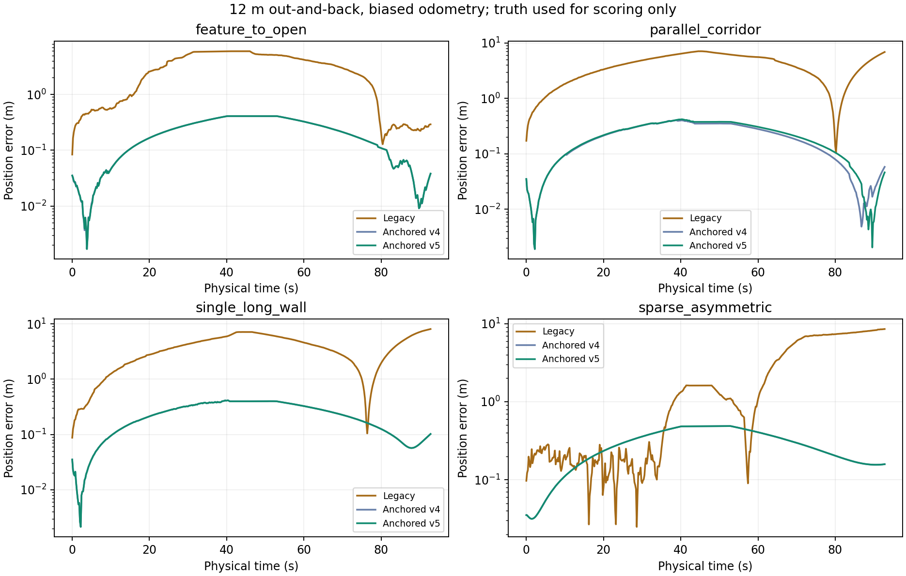
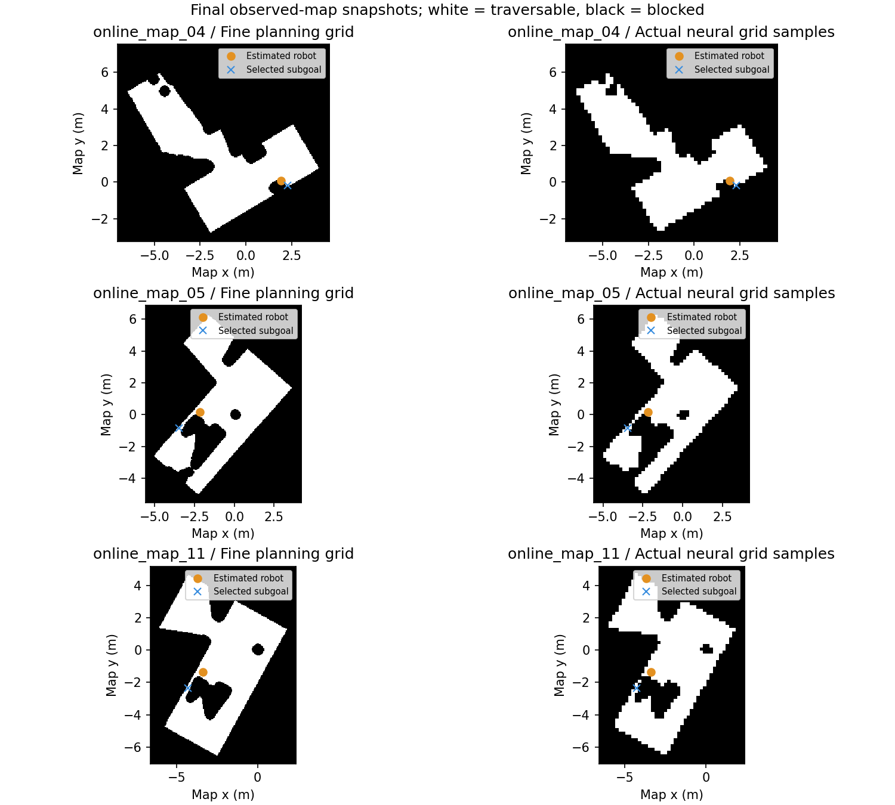
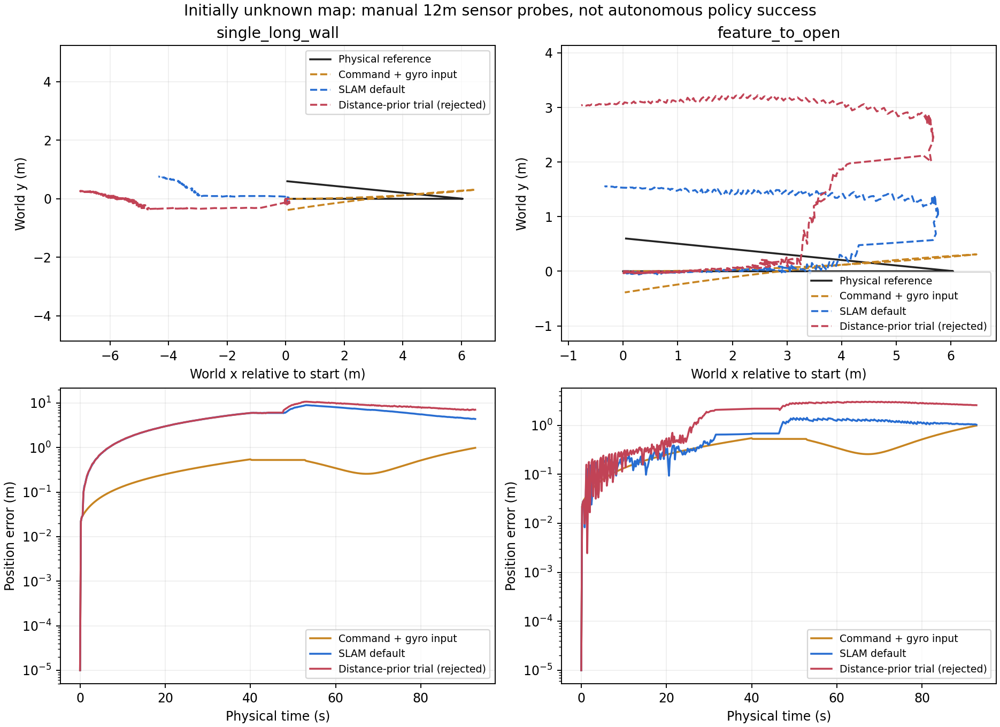

# 定位、建图与停车优化结果 · 2026-10-15

完成时间：北京时间 2026-10-15T05:55:46.914789+08:00。结果来自本地仿真、独立物理标签与实车录制回放；不等同于已经通过实车部署验收。

停车阶段选择 **boundary_ppo_8000**，保存为 `models/localization_mapping_20261015/selected_known_map`；综合导航回归后，优先研究候选为 **尚无同时通过回归的候选**。原实车 2026-10-14 质量恢复 2k 模型保留。边导航边建图尚未达到交付目标，长距离弱特征漂移也未解决；本轮没有替换或部署实车模型。

## 1. 导航、避障与方向停车

以下每行使用相同一组 48 个验证任务：16 个临界角度对齐、16 个接近后停车、16 个正常导航任务。全部雷达量程 10 m；部分任务额外随机无效束 8%，另有整帧中断、初始位姿偏差和低速横穿任务。不是全部 48 项都具有 8% 额外缺失。地图沿用阶段验证地图，任务与种子新增；这是验证集，不是全新真实地图泛化验收。

| 模型 | 安全成功 | 接触安全事件 | 超时 | 假到达 |
|---|---:|---:|---:|---:|
| boundary_warmup | 48/48 | 0 | 0 | 0 |
| retained_5k | 42/48 | 0 | 3 | 3 |
| boundary_ppo_8000 | 48/48 | 0 | 0 | 0 |

方向任务坚持：物理位置误差 <12 cm、方向误差 <0.15 rad（8.6°）、实际线速度 <0.03 m/s、角速度 <0.08 rad/s，稳定 0.4 s。位置任务保留 20 cm 判定。机器人轮廓、安全余量与动作限制没有缩小。

旧 28 项开发回归：原 5k 方向模型 26/28；示范预热和追加 3k PPO 均 27/28，方向任务 24/24。原 `motion_profile_015` 接触安全失败仍在；临界角度 `docking_dev_02` 不再长时间停在角度容差外。开发任务曾用于修复，不能把它称为最终独立测试。

真实部署的 2k 基线为位置模型，用相同 16 个位置导航任务另行比较，避免把它不支持的方向任务算作失败：

| 模型 | 安全成功 | 接触安全事件 | 超时 | 假到达 |
|---|---:|---:|---:|---:|
| boundary_warmup | 16/16 | 0 | 0 | 0 |
| real_deployed_2k | 15/16 | 1 | 0 | 0 |

再用原发布记录中的 12 个历史避障任务成对回归（急反向、原训练失败、停走和独立横穿各 3 个；位置目标），这些是历史回归任务，不属于新地图泛化：

| 模型 | 安全成功 | 接触安全事件 | 超时 | 假到达 |
|---|---:|---:|---:|---:|
| real_deployed_2k | 11/12 | 1 | 0 | 0 |
| selected_8k | 9/12 | 2 | 1 | 0 |

终端分支外沿停车专项：目标距起点 10.2～11.9 cm、不同方向，共 4/4 通过。它验证 10 cm 分支门限外的行为，没有为通过测试扩大门限。

### 实车输入核对与退化对照

**48 项主验证使用带噪声的实际运动反馈，不能直接当成这轮实车输入的精确复现。** 重新核对录制配置后确认：底盘 `odom_source=command`，但 `/odom` 的 EKF 已融合 `/imu` 角速度。录制也包含有效轮反馈与 `/wheel/odom`，只是当前底盘没有选轮反馈作为里程计源。因此不能说实车没有 IMU，或把完全按指令积分转向当作当前 EKF 的精确模型。

实车 IMU 约 100 Hz；角速度与 `/imu` 的对照 RMSE：指令里程计约 0.170 rad/s，融合 `/odom` 约 0.049 rad/s。此差异证明输入链不同，不是绝对航向精度。轮反馈存在也不代表已经验证轮径、CPR、滑移或绝对地图定位。详见 `REAL_SENSOR_INPUT_AUDIT.json`。本轮没有更换实车的里程计源，也不要求新增编码器。

先保留完全指令积分的退化对照：上一速度指令会继续积分，即使启动迟滞、受阻或打滑使车体没有移动。该路径只用实际发布的 `(vx, wz)` 与时间积分，不读取仿真位姿或实际运动反馈；真值仅用于判定是否真正到达。

| 条件／集合 | 安全成功 | 接触安全事件 | 超时 | 假到达 |
|---|---:|---:|---:|---:|
| 指令积分：8 项混合检查 | 7/8 | 0 | 0 | 1 |
| 指令积分：8 项实际行驶＋方向任务 | 4/8 | 2 | 0 | 2 |

8 项混合检查包含 4 个近原地目标，不适合作为长距离导航能力证据。另 8 个行驶任务包含 4 个静态与 4 个动态横穿任务，每个任务均保留方向目标。以下再去掉方向要求，用同样的 8 个行驶场景公平比较原 2k 位置模型与新模型：

| 模型 | 安全成功 | 接触安全事件 | 超时 | 假到达 |
|---|---:|---:|---:|---:|
| real_deployed_2k | 8/8 | 0 | 0 | 0 |
| selected_8k | 4/8 | 2 | 0 | 2 |

- command_position_crossing：real_deployed_2k 4/4；selected_8k 0/4。

- command_position_static：real_deployed_2k 4/4；selected_8k 4/4。

**退化输入下存在明显回归。** 不能只公布 48/48 而忽略上述挑战，但也不能把纯指令转向对照称为本次真实 EKF 的直接验收。以下再按录制已有的传感器组合补测：指令平移＋模拟 IMU 转向，融合权重 0.8、额外 gyro bias 0.003 rad/s 均为实验假设，使用现有含噪角运动传感器，不读取参考位姿或实际平移反馈。它不是完整复现 ROS EKF：

| 模型／指令平移＋IMU 转向 | 安全成功 | 接触安全事件 | 超时 | 假到达 |
|---|---:|---:|---:|---:|
| real_deployed_2k | 6/8 | 1 | 1 | 0 |
| selected_8k | 8/8 | 0 | 0 | 0 |

再保持相同传感器近似条件，验证 8 个具有目标朝向的移动任务和 4 张新增地图的 8 个位置任务。方向对照双方均支持方向目标；新增地图对照才包含原 2k 位置模型，不把未支持的目标朝向算作它失败。

| 模型／集合 | 安全成功 | 接触安全事件 | 超时 | 假到达 |
|---|---:|---:|---:|---:|
| preserved_turn_v6／IMU 方向移动 | 8/8 | 0 | 0 | 0 |
| selected_8k／IMU 方向移动 | 8/8 | 0 | 0 | 0 |
| preserved_turn_v6／IMU 新图位置 | 4/8 | 0 | 3 | 1 |
| real_deployed_2k／IMU 新图位置 | 5/8 | 0 | 2 | 1 |

新增稀疏地图中有一例候选扫描几乎全为 `Inf`，400 帧约 99.95% 束非有限值，后续触发 `scan_unavailable` 停车；旧模型却继续移动并发生约 8.7 m 的定位 P95 误差。此例要区分无目标回波、驱动无效数据和断流，不能通过取消停车保护“修好”。当前仿真对无回波与部分丢点都使用 `Inf`，尚未提供独立的扫描健康／有效性掩码。此观测语义修改需要训练、导出与部署合同一起升级，不能直接把全部 `Inf` 当作可靠空闲。

### 保留原导航策略的补充对照

为区分策略与定位输入变化，另外导出了组合模型：位置目标全程采用原部署 2k actor；方向目标距终点大于 30 cm 时仍采用原 2k actor，接近后采用已训练的方向接近／停靠 actor。两个部分均为学习策略，同样的 12 个动作与实时掩码；1024 个观测核验原导航分支输出逐位一致。没有运行专家转向控制器，也没有把组合导出计为额外 PPO 步数。完整两个父 checkpoint 保存在 `training_parents`，未声称有新的统一 PPO 优化器。

| 候选／条件 | 安全成功 | 接触安全事件 | 超时 | 假到达 |
|---|---:|---:|---:|---:|
| 原导航＋新停靠＋v5：48 项运动反馈 | 48/48 | 0 | 0 | 0 |
| 原导航＋新停靠＋v5：8 项指令积分位置目标 | 4/8 | 2 | 0 | 2 |
| 原导航＋新停靠＋v6：48 项运动反馈 | 48/48 | 0 | 0 | 0 |
| 原导航＋新停靠＋v6：8 项指令积分位置目标 | 6/8 | 1 | 0 | 1 |
| 原导航＋新停靠＋v6：8 项指令平移＋IMU | 8/8 | 0 | 0 | 0 |
| 原导航＋新停靠＋v6：12 项历史避障 | 11/12 | 1 | 0 | 0 |

v6 仅在原静态精修候选之外增加纯航向候选，再由相同静态残差选择；保留 v5 的纠正速度上限、未知障碍过滤与可观测方向投影。其固定指令回放改善了一个退化片段，但也使部分其他片段误差变大，必须依据上面的闭环验证判断，而不是只选改善的回放。它不是新的全网训练，也没有提高机器人速度。

保留原 actor 并不等于完整闭环一定不退化：定位位姿、标准差、地图匹配与动作掩码变化后，原 actor 仍可能看到不同的输入。静态支持不足期间的指令积分漂移与错误高置信度需要单独解决。

进一步用没有参与 RL 训练的 4 张新增几何地图测试实际行驶与方向停车：有特征房间、稀疏不对称障碍、重复柱体、从有特征区域进入开放区域；每张 2 个固定任务。全部 10 m 量程、8% 额外缺失、指令积分输入。地图曾用于本轮定位诊断，因此属于新增地图验证，而非完全未查看的密封测试集：

| 集合 | 安全成功 | 接触安全事件 | 超时 | 假到达 |
|---|---:|---:|---:|---:|
| 新增 4 图／8 个指令积分导航任务 | 2/8 | 0 | 5 | 1 |

- approach_and_stop 共同成功 14 项：平均用时 4.91 → 4.97 s，实际路程 0.500 → 0.516 m。只比较共同成功任务，不用失败提前结束的时长制造加速结论。

- boundary_alignment 共同成功 12 项：平均用时 3.98 → 2.00 s，实际路程 0.000 → 0.000 m。只比较共同成功任务，不用失败提前结束的时长制造加速结论。

- navigation_regression 共同成功 16 项：平均用时 31.75 → 31.58 s，实际路程 4.833 → 4.765 m。只比较共同成功任务，不用失败提前结束的时长制造加速结论。

局部安全停止、动作掩码和正常导航能力仍需更大样本实车验证。本轮不证明全局最短或超过 TEB，也没有上调速度到 0.4 m/s。

## 2. 已知二维栅格地图定位

采用连续里程计预测，再让有静态地图支持的雷达观测提供有限纠正。新增、未入图障碍物不用于拉动地图定位；它们仍完整进入避障扫描。沿长墙等不可观测方向保留里程计，不让尖锐网络概率冒充可信位置。定位网络权重没有重新训练；改进来自静态支持筛选、估计与 v5 初始对齐逻辑。

24 条成对轨迹、每种条件 4 条。表内数值为各轨迹位置误差 P95 的中位数，单位厘米，不是所有帧混合计算的全局 P95：

| 条件 | 旧定位 | 里程计锚定 v4 | v5 候选 |
|---|---:|---:|---:|
| normal_feedback | 3.80 | 1.01 | 0.98 |
| small_initial_offset | 2.92 | 4.28 | 1.93 |
| unmapped_obstacle | 2.50 | 1.07 | 1.04 |
| missing_sector | 3.31 | 0.98 | 0.85 |
| command_odometry | 3.97 | 4.96 | 4.96 |
| command_and_unmapped | 4.18 | 2.61 | 2.61 |

命令积分与新障碍物叠加时，位置改善并不意味着每个航向指标都更好；原始每任务数据在 `known_map_validation/RESULTS.json`，保留反例。

新增 6 种几何、36 条短轨迹（每条约 16 s），同样按每场景 6 条任务 P95 的中位数统计厘米：

| 几何 | 旧定位 | v4 | v5 |
|---|---:|---:|---:|
| feature_to_open | 159.96 | 3.15 | 3.41 |
| informative_closed | 3.52 | 0.79 | 0.78 |
| parallel_corridor | 340.23 | 3.54 | 3.52 |
| repeated_columns | 174.20 | 3.26 | 3.26 |
| single_long_wall | 219.35 | 4.29 | 4.29 |
| sparse_asymmetric | 125.27 | 4.95 | 4.95 |

开放地图外边界不作为物理墙，图像补齐只限制规划未知区。以上是仿真短轨迹结果，不能解释成稀疏场景长期厘米级精度。

更长的 12.06 m 往返、92.8 s 专项加入 +8% 平移尺度、+2.5% 角增量尺度和 0.001 m/s 横向偏差，雷达 10 m、8% 丢点。v5 各轨迹位置 P95：

| 场景 | v5 P95（cm） | v5 末端误差（cm） |
|---|---:|---:|
| single_long_wall | 39.79 | 10.20 |
| parallel_corridor | 39.24 | 4.62 |
| sparse_asymmetric | 48.61 | 15.80 |
| feature_to_open | 40.88 | 3.81 |

**长距离弱特征漂移仍未解决。** 最大轨迹 P95 约 48.6 cm。返回有特征位置时可部分纠偏，但不能据此保证空旷区域不漂移。当前里程计若积分指令速度，它不是轮子实际运动测量；本轮没有要求增加编码器，也没有修改固件。这些误差范围是仿真假设，不是从录制中识别出的标定值。

实车记录共回放 1516 帧；v5 接受静态匹配 532 帧。此前两段原定位累计位移约 0.74 m、1.35 m，在不受支持的匹配被拒绝后，候选随录制里程计约移动 5.5 cm、2.5 cm。这证明错误地图纠正被抑制；由于没有独立参考位姿，不能声称这就是实车绝对精度，也不是闭环导航成功率。

## 3. 边导航边建图

接入实际 SLAM Toolbox：同一退化扫描与带偏差里程计提供地图和位姿，actor 只使用已观测地图。临时障碍物在避障输入中保留，静态建图对已知空闲区域中的新回波设置持续观测筛选，避免瞬时物体污染静态地图。地图更新保留仍有效的路线；大坐标纠偏后清除旧坐标系感知记忆并停车重新观察。等待地图时也更新雷达、定位和执行 STOP 历史。

| 集合 | 安全成功 | 接触安全事件 | 超时 | 假到达 |
|---|---:|---:|---:|---:|
| 6 项开发修复回归（12 m 量程） | 6/6 | 0 | 0 | 0 |
| 12 项新种子验收（10 m 量程） | 5/12 | 1 | 4 | 2 |

两行任务、量程及模型不同，不能作为同输入严格前后成功率。6 项已反复用于开发修复；12 项是后续新增任务，包含 6 个遮挡目标和 4 个低速横穿障碍。每项先有监督 360° 扫描初始化，费用、轨迹与物理事件单独记录。子目标选择仍是工程化的已观测区域选择器，未知全局探索尚非全强化学习。速度与转向决策由现有 RL actor 执行。

**边建图模式没有通过实车部署验收。** 失败没有从总成功率中删除：

- online_map_01：接触安全事件；定位位置 P95 4.0 cm，末端目标距离 4.92 m。

- online_map_03：假到达；定位位置 P95 29.7 cm，末端目标距离 0.33 m。

- online_map_04：超时；定位位置 P95 10.8 cm，末端目标距离 0.19 m。

- online_map_05：超时；定位位置 P95 3.0 cm，末端目标距离 2.89 m。

- online_map_07：超时；定位位置 P95 4.4 cm，末端目标距离 4.70 m。

- online_map_09：假到达；定位位置 P95 10.5 cm，末端目标距离 0.15 m。

- online_map_11：超时；定位位置 P95 5.2 cm，末端目标距离 2.87 m。

边建图也单独切换为指令积分输入，以原 12 项中的前 4 项为固定子集；不读取实际运动反馈：

| 集合 | 安全成功 | 接触安全事件 | 超时 | 假到达 |
|---|---:|---:|---:|---:|
| 边建图＋指令积分 4 项 | 2/4 | 0 | 1 | 1 |
| 原导航组合＋粗栅格一致子目标：相同 4 项 | 2/4 | 0 | 1 | 1 |
| 边建图＋指令平移／IMU 转向：相同 4 个物理任务 | 2/4 | 0 | 1 | 1 |

### 新增失败诊断与受限修复试验

离线复查发现：`online_map_05` 最终保存的细栅格连通，神经路由器实际使用的 `[2::4,2::4]` 规划格断开；原子目标选择只检查细栅格。`online_map_11` 粗栅格虽连通，学习路由仍出现不完整路径。两者不是同一个故障，不能用放松碰撞轮廓或单纯增加停车训练来修复。

诊断使用最终保存地图与当时估计位姿，不是每帧历史地图的精确重建；其范围见 `online_final_validation_12/FAILURE_DIAGNOSIS.json`。部分假到达样本的估计误差明显超过报告标准差，SLAM 协方差下限未经过实车标定。

| 试验 | 安全成功 | 接触安全事件 | 超时 | 假到达 |
|---|---:|---:|---:|---:|
| 稳健扫描增量：3 个原失败任务 | 0/3 | 1 | 2 | 0 |
| 稳健扫描增量：8 个新种子任务 | 4/8 | 0 | 1 | 3 |
| 有限雷达射线空闲层：3 个原失败任务 | 0/3 | 0 | 2 | 1 |
| 与粗规划格一致的子目标：3 个原失败任务 | 1/3 | 0 | 2 | 0 |
| 仅已知空闲区写入动态路由层：相同 4 个 IMU 物理任务 | 2/4 | 0 | 2 | 0 |

不同试验集合不能互相当作严格算法排名。扫描增量的较早版本在 12 项计划中完成 4 项后止损，证据见 `online_laser_increment_pair_12/EARLY_STOP.json`；不能把未完成的 12 项计为已评估。

扫描增量采用相邻有限扫描的点到线匹配、稳健残差与弱轴退回指令积分；并非已复现 Censi 论文的闭式 CSM。有限射线空闲层只清除实际测量射线经过的未知格，不删除占据格、不过墙、不把无效回波当空闲。粗网格子目标试验只匹配真实神经输入的连通分量，没有引入 A* 速度控制。

新增动态路由层对照只在在线建图显式开关下启用：未知区域已由静态规划图保守阻塞，不再将该区域回波重复投影并膨胀进动态记忆；已观测空闲区中的新障碍物继续写入，actor 和安全层保留原始扫描。它不删除障碍格、不减小车身或安全余量，默认关闭。静态最终图的贪心解码屏蔽试验也没有改善路径，因此未增加到运行时。

这些替代试验没有通过完整验收，全部默认关闭，作为失败证据保留；既有地图模型不受这些可选分支影响。

持久图恢复：新 SLAM 进程加载 `.posegraph`＋`.data`，原占据格恢复比例 99.74%，原起点 20 帧定位 P95 0.76 cm。只验证原起点恢复，不是任意位置重定位。回环配置已开启，但没有独立测量本轮回环精度。

已有保守接触指标会在 MuJoCo 的 1.5 cm 接触 margin 内触发。物理命令回放确认新动态失败中至少有一例机器人已停车、横穿物体仍接近；它计入失败，不将其当作已证实实体穿透。详细几何与最小有符号距离见 `online_final_validation_12/CONTACT_DIAGNOSIS.json`。不能以放宽碰撞判定提升成绩。

RF2O 6 项对照（不采用）：安全到达 4/6，假到达 2 次。

RF2O 对照出现两次假到达，因此默认使用带误差里程计＋SLAM Toolbox，不自动改用 RF2O。

### 更长的在线建图定位测量

追加两条约 12 m、92.8 s 的脚本驱动传感器轨迹，起始没有完整地图；SLAM 只读取退化雷达、指令平移和模拟 IMU 转向。设置 +8% 指令平移尺度误差、0.003 rad/s 陀螺仪偏置、10 m 量程和额外 8% 丢点。独立参考位姿只用于评分，没有进入地图或定位输入。这是定位测量，不是 RL 自主导航成功。

| 场景 | 指令＋IMU 位置 P95（cm） | 在线 SLAM 位置 P95（cm） | SLAM 末端（cm） | 有估计帧／总帧 |
|---|---:|---:|---:|---:|
| single_long_wall | 80.55 | 848.92 | 439.13 | 465/465 |
| feature_to_open | 80.55 | 133.57 | 102.66 | 465/465 |

SLAM 表内统计所有有输出的帧，原始结果同时提供扫描匹配位姿年龄不超过 1 s 的子集，避免隐藏过期估计。回环开关已启用，但没有禁用回环的同输入对照，不能把误差变化全部归因于回环；也未验证未知区域长期无漂移或任意初始位置重定位。

针对单面长墙退化，再保持相同脚本、种子、输入与回环配置，只把 Karto 的 `distance_variance_penalty` 从默认 0.5 调至实验值 0.0025。官方实现中，此值控制偏离里程计搜索中心的惩罚，较小值提高相应约束，并不创造沿墙绝对位置观测。这是有待标定的 SLAM 参数对照，没有替换原默认配置。

| 相同场景 | 原 SLAM 位置 P95（cm） | 强里程计先验 SLAM 位置 P95（cm） | 强先验末端（cm） |
|---|---:|---:|---:|
| single_long_wall | 848.92 | 1033.61 | 708.60 |
| feature_to_open | 133.57 | 299.84 | 257.38 |

**该参数对照失败，两个场景都变差，已拒绝采用。** 默认配置保留。当前在线 SLAM 在这些弱几何长轨迹下本身就不可靠；定位输出、低航向误差或持久图保存成功，均不能代替位置精度验收。

来源：[SLAM Toolbox / Karto 里程计惩罚实现](https://github.com/SteveMacenski/slam_toolbox/blob/humble/lib/karto_sdk/src/Mapper.cpp#L622) 与[官方 Humble 默认配置](https://github.com/SteveMacenski/slam_toolbox/blob/humble/config/mapper_params_online_async.yaml)。误差改善是否成立只以上述本地配对测量判断；参数来源不是实车精度证明。

## 4. 本轮训练、加载与资源

完成追加 6k PPO 的对照与示范辅助追加 3k PPO。追加 6k 单独训练仍为 26/28，未优于原模型；有针对性的临界角度示范辅助才修复停车停滞。600 次监督预热之后的追加 3k 是 PPO，采样动作与执行动作、采样时掩码与概率保持一致。只统计真实物理闭环验收，示范标签准确率 79.3% 不替代导航结果。

网络权重核验：停车训练的正常导航 actor 与其 5k 方向父模型逐张量一致，变化仅 critic 和 terminal_actor；它本来就不同于实车 2k actor。保留原导航的组合候选另用实车 2k actor，并核验正常分支输出一致。localizer/router 网络文件 SHA 相同。保存完整父 PPO checkpoint、合同、种子、优化器与源码版本；新增验证还保存源文件快照与 bundle hash。

本机新进程、热文件缓存测量：旧训练模块依赖导入加载 2.86 s / 540.0 MiB；纯便携运行时 1.98 s / 467.6 MiB。目标切换约 0.08 ms，网络与定位状态保持驻留。不是 Jetson Orin Nano 测量。

ROS 部署回调现在保留目标四元数方向；新目标更新与人工初始位姿重置分开处理，避免每设一个目标就重载网络、丢失定位历史。适配器、worker、便携运行时和模型合同需配套更新。本轮核验了回调、驻留状态及便携运行时构造；归档适配器不是完整 ROS 运行包，未做完整适配器 ROS 启动或实车执行验证。

单线程、低优先级与软 CPU 配额持续启用；SLAM 子进程限制一个逻辑 CPU。实验资源日志中的 RSS 与 CPU 一般只统计父进程，不能误报为整个系统消耗。较大的旧 SLAM 图已无损压缩，全部原有用户文件和原部署模型保留。

## 5. 下一步按证据推进

1. 已有地图：保留停车与组合候选，先补充扫描健康掩码和“无回波／无效数据／断流”的语义对照，并在新增地图中分析假到达；当前组合版本没有通过泛化不退化门槛。采集独立参考位姿或人工测量点，复测新增障碍物、原地定向停车与长走廊。定位精度不能只依赖网络输出置信度。

2. 边建图：优先解决动态障碍进入后方盲区、停转无法脱离与局部路线不完整。先建立相同扫描/地图/里程计的失败片段，诊断动作可行集合与预测跟踪，再微调正常 actor 的相应状态；冻结 actor 的停车专项不会学会新的未知地图避障行为。

   具体训练范围应扩大到：传感器可见部分地图的 router 监督与常态 actor 微调；同一物理场景保留完整碰撞几何，策略只读取部分图。优先统计细／粗网格断路、神经路由环路和掩码只剩 STOP 三类，不能把三者都当作策略不肯前进。训练与验证加入录制已有的指令平移＋IMU 转向条件，同时保留纯指令退化及正常运动反馈对照。

3. 长距离弱特征：优先检查在线 SLAM 顺序匹配、近邻图约束和回环在弱几何方向上的可观测性；不能只调一个里程计惩罚参数。保留融合里程计预测、拒绝不受支持的全局纠正，并把退化不确定性反馈给导航停车。使用真实连续数据校准过程噪声、时间同步和底盘响应。若无外部绝对约束，不承诺无限期无漂移。持久图、重访特征和回环需建立长轨迹实测验收。

4. 泛化：保留未知地图、同图新路线和已用开发任务三组，新增地图与多个种子；当前单种子停车微调和小规模建图验收还不足以证明强泛化。

5. 主控性能：在目标 Orin Nano 上测端到端 P95/P99、掉帧与超时比例，再决定量化或蒸馏；本机启动变快不代表目标板已满足预算。

## 6. 查看与复现

[交互轨迹回放](index.html) · [机器可读汇总](SUMMARY.json) · [复现、边界与环境说明](REPRODUCE.md)。原始每任务结果、位姿与实际指令保存于相应评估目录。

参考：[SLAM Toolbox 官方项目](https://github.com/SteveMacenski/slam_toolbox)、[RF2O 官方项目](https://github.com/MAPIRlab/rf2o_laser_odometry)、[Censi 点到线 ICP 原论文](https://censi.science/pub/research/2008-icra-plicp.pdf)、[robot_localization 官方说明](https://github.com/cra-ros-pkg/robot_localization/blob/rolling-devel/doc/configuring_robot_localization.rst)。本轮仿真阈值与训练实验是项目验证结果，不是论文已经证明的实车保证。
