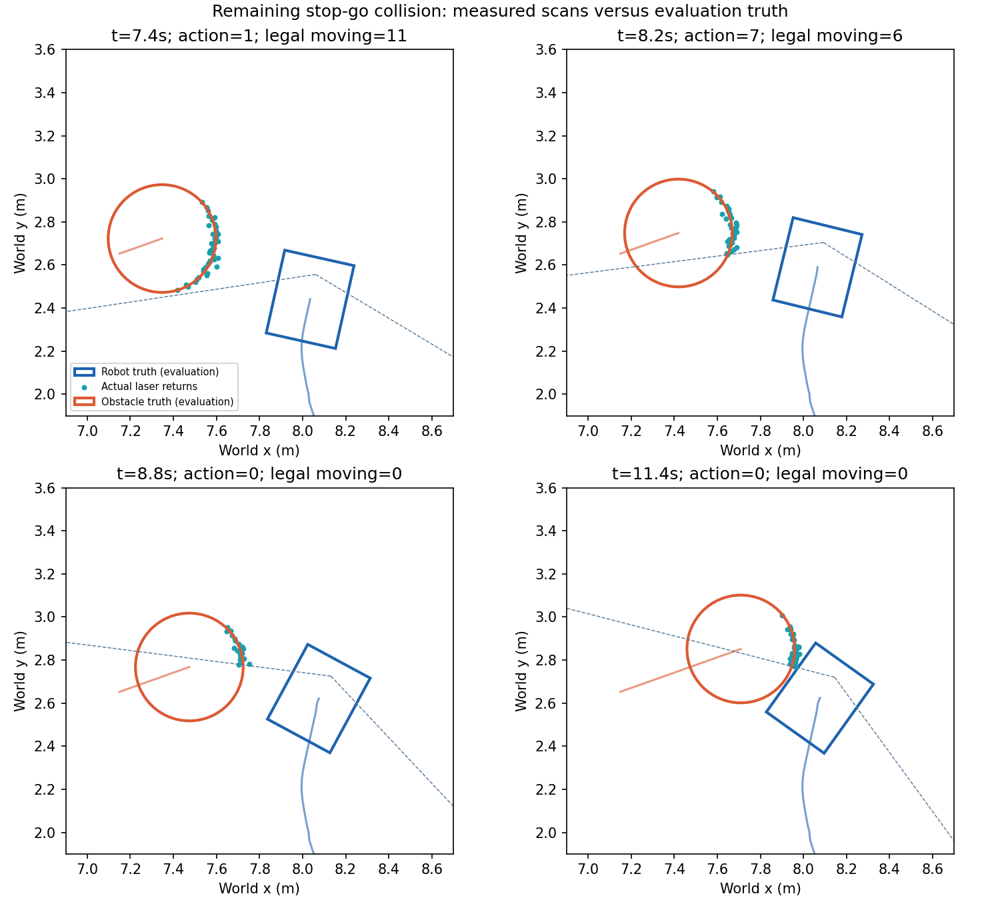

# 动态等待与绕行专项修复

原模型保留。先诊断、做机制对照，再做单独的训练覆盖对照；不自动发布候选。

## 诊断与改动

- 遮挡造成轮廓中心变化，会污染速度估计；新增连续轮廓的点到线平移配准实验，保留低几何约束时的未知状态。
- 原 015 的末段仍有少量真实障碍回波，并非完全看不见；8.8 秒后只有停止可选，机器人在障碍运动通道上停车，随后约 2.8 秒发生接触。需要提前选择安全通过或停车位置。
- 历史轨迹的存在不能表示本帧有新测量；新实验明确使用原测量时间，不延长可靠速度的保持时间。
- 第二个配准实验同步用配准信息与跨时间估计分歧计算误差，避免把轮廓中心变化再次计入；这不是经过实车标定的置信区间。
- 将未来多时刻占据并成硬墙会诱发全局折返；另做单项路线实验：真实/持久障碍仍为硬限制，未来单独使用软代价。局部预测掩码、原始扫描、车体和保护间距保持不变。
- 新增配对模型选择检查：逐例安全不退化，再检查共同成功任务的路程、耗时；旧 2k PPO 未通过效率检查。
- 离线物理标签与预测速度在同一里程计坐标轴比较：8.0 秒处配准误差约 0.011 m/s、旧估计约 0.098 m/s；8.8 秒处配准又退化到约 0.128 m/s。单个时刻的速度改善不能替代遮挡全过程验收。标签只用于评估。

## 已完成闭环结果

| 实验 | 任务 | 安全到达 | 碰撞 | 超时 |
|---|---:|---:|---:|---:|
| 原约束候选（历史已完成配对记录） | 2 | 1 | 1 | 0 |
| registered_failure_2 | 2 | 0 | 1 | 1 |
| residual_failure_2 | 2 | 0 | 2 | 0 |
| soft_failure_2 | 2 | 0 | 1 | 1 |
| stop_go_ppo/paired_12 | 12 | 11 | 1 | 0 |
| critical_clone_ppo/paired_12 | 12 | 11 | 1 | 0 |

三项机制实验没有通过，均拒绝；它们不进入新的 PPO 训练，也不改变原模型。不能用合成跟踪检查通过宣称导航已改善。失败产物与各次源代码快照保留。

## 训练覆盖对照

新增两个已知停走横穿场景的参数变体（不同随机种子、起点/初始角度、速度及暂停持续时间），并保留原 w11 训练难例；三回合专项、一回合正常任务。固定 motion_profile_015 原案例不原样回放训练，但同场景族已经用于开发，仍不称为独立泛化测试。
保持原 V2 约束、观测、奖励和动作；从相同原生 PPO 起点追加 2,000 步，训练后自动做 12 例训练前后配对检查。这里只训练提前启用的恢复残差和 critic。
残差版完整结果：11/12 安全到达、1 次碰撞、停车 6/6；共同成功任务总路程 +2.10%，总耗时 -0.91%，未通过效率检查。015 原记录 58 帧动作均未改变。
7.4～8.6 秒属于可训练状态；8.0 秒旧策略偏好慢速转向，对最快合法动作的分数领先约 0.32，8.2 秒约 1.37，而学习修正幅度仅约 0.02。该诊断说明关键决策尚未改写，不能据此强制加速或认定某个替代动作安全。
新增单因素对照：用已有 actor 的完整特征与动作头初始化一个可训练副本，仅在同一传感器条件下启用；开阔状态仍用冻结原策略，定位、路由与方向停车保持原版。观测、动作、奖励、掩码与训练数据保持一致，原生初始动作一致性和可续训检查通过。
最新流水线状态：complete。具体进度见 [残差试训](stop_go_ppo/status.json)、[副本试训](critical_clone_ppo/status.json)。

## 两次 PPO 的固定配对检查

| 实验 | 状态 | 安全到达 | 碰撞 | 方向停靠 | 共同成功路程变化 | 共同成功耗时变化 | 安全及效率检查 |
|---|---|---:|---:|---:|---:|---:|---|
| stop_go_ppo | complete | 11/12 | 1 | 6/6 | +2.10% | -0.91% | 未通过 |
| critical_clone_ppo | complete | 11/12 | 1 | 6/6 | +8.78% | +3.80% | 未通过 |

只比较两版均成功任务的路程与耗时；碰撞后提前结束的短轨迹不算效率提高。逐例检查还禁止用一个任务的改善抵消另一个任务的新增碰撞或失败。
准入范围在评估前固定：成功任务总路程最多增加 2%、总耗时最多增加 5%，单任务最多增加 20%；扩大训练还要求这 12 个开发任务全部成功。此门槛用于本轮开发对照，不代表实车部署已验收。

最新候选未通过扩大训练门槛，原模型继续保留。新的策略文件与完整训练状态单独存储，不替换运行入口。

副本策略在原 015 传感器记录的 58 帧中改变 11 帧动作，包括 8.0～8.6 秒仍有可行动作的阶段。该结果只证明决策已改变，闭环安全与效率以上表为准。
[固定传感器动作对照](clone_recorded_decisions.json) · [策略分数诊断](clone_logit_margins.json)

## 后续修复的具体入口

原失败记录中，两种预测对比差异超过 0.25 的帧有 12/58，其中停车风险有 9 帧。actor 的质量风险来自地图坐标系 laser-fusion 轨迹，保护层来自里程计坐标系的累计轮廓假设；它们读取相同退化雷达，但预测状态、轮廓和不确定性不同。差异不代表已经证明哪套估计正确。
8.8 秒时，保护层所有动作预测接触约 0.4 秒，actor 质量输入中停车风险仍为 0。需要在新观测合同中对齐预测来源，并显式保留停车风险、测量年龄和未知状态；不能偷偷替换旧 300/303 维输入的含义。
历史实测轮廓补全的离线原型也未通过：8.4 秒处原 V4 仍有 5 个运动动作未被该预测层否决，补全原型反而全部否决。该原型不接入运行入口，不启动新的大规模训练。
下一次训练应先验证统一预测在横穿、停走、反向、静态障碍和丢帧恢复中误差与错误高置信度，再训练提前通过/让行/安全停车。沿用独立物理碰撞标签、完整车体与正常任务回归。
[风险输入对照](dynamic_risk_input_audit.json) · [未通过的轮廓补全回放](completion_sensor_shadow.json)

最新试训 2,000 步中，可参与策略更新的状态只有 377（18.9%），仅停止可选 1063 步。后续应按有效决策样本数和闭环改善决定训练预算，避免把大量无选择的等待步当成充分训练。

功能与训练实现检查：47 项通过；这是实现检查数量，不是导航成功次数。

## 验证与限制

本轮不修改定位器权重、方向停靠 actor、底盘尺寸、12 个动作或速度上限。当前约束不包含倒车，边界条件保持可追溯。
原 V2 对 58 帧传感器回放的动态接触时间与此前记录完全一致，旧候选没有被静默改变。
实验服务单线程、CPU 硬上限 50% 单核，软平均 0.4 核，内存硬上限 4 GiB。
这些案例已经用于开发，不能称为未见场景泛化。此轮不构成未知环境 SLAM、实车定位精度或 Orin 实时性的验收。

[详细数据](SUMMARY.json) · [旧 PPO 效率检查](previous_ppo_efficiency_gate.json) · [传感器逐帧诊断](motion_shadow_v2_v3.json) · [同坐标轴速度误差](prediction_velocity_error.json)

图中的物理轮廓和轨迹只用于离线评估，策略只接收传感器输入。
