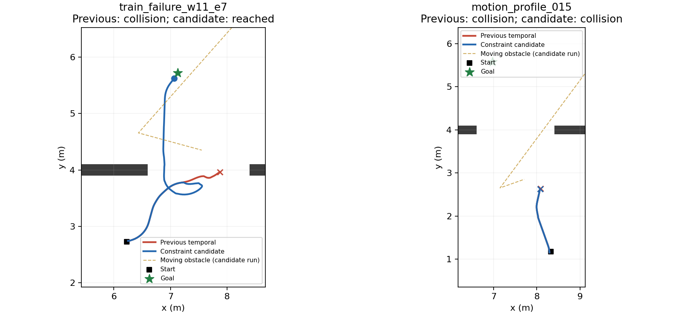

# 动态动作约束与弱几何不确定性优化（2026-10-15）

本轮已完成代码、独立候选包和验证。相对上一轮 temporal 定位候选，12 个固定开发/回归场景从 **10/12 安全到达、2 次碰撞**变为 **11/12 安全到达、1 次碰撞**，均无超时和假到达。只修复了其中一个原有碰撞；**未通过部署验收，原部署模型未替换**。

## 修改内容

- 用当前雷达、连续里程计和实际反馈速度预测短时碰撞，在 actor 选择动作前屏蔽危险候选。跟踪使用 odom 坐标，地图定位修正不会直接制造障碍运动。
- 缓存同一传感器时刻的预测；观测中的动作探测、训练掩码和执行检查共享该结果。保留原有静态/雷达制动检查、0.04m 安全余量、真实车体和 12 个动作。停止动作始终可选。
- 累计比较可见轮廓，减轻逐渐遮挡造成的速度偏差；运动假设有明确的原始测量年龄和 1.2s 上限。它仍只描述可见点轮廓，不保证完整物体形状、突变运动或盲区安全。
- 在缺少约束的方向累计里程计误差预算，避免用大量小步积分得到过于乐观的不确定性。该预算未标定；不改变位姿估计本身。
- 更新动作合同校验、导出及加载流程，防止模型和硬件配置混用不同版本的掩码。actor、router、localizer 权重、定位核和方向停靠合同逐字节保持一致。本轮没有增加 PPO 步数。

## 闭环对照

两组使用相同的 12 个任务、种子、车体、动作和物理到达/碰撞标准。仿真真值只用于评分和绘图，不进入新增约束。该集合已用于开发，不能称为新的泛化测试。

| 项目 | 上一轮 temporal 候选 | 本轮组合约束候选 |
|---|---:|---:|
| 总安全到达 | 10/12 | 11/12 |
| 动态场景到达 | 4/6 | 5/6 |
| 停靠/近目标回归 | 6/6 | 6/6 |
| 碰撞 | 2 | 1 |
| 超时 / 假到达 | 0 / 0 | 0 / 0 |

| 场景 | 上一轮 | 本轮 | 本轮时间 / 路程 |
|---|---|---|---:|
| train_failure_w11_e7 | 碰撞 | 到达 | 38.6s / 4.579m |
| motion_profile_015 | 碰撞 | 碰撞 | 11.6s / 1.540m |
| motion_profile_002 | 到达 | 到达 | 56.2s / 8.523m |
| motion_profile_000 | 到达 | 到达 | 32.6s / 3.449m |
| independent_dynamic_000 | 到达 | 到达 | 51.4s / 7.549m |
| independent_dynamic_001 | 到达 | 到达 | 23.0s / 3.786m |
| localization_nav_00 | 到达 | 到达 | 0.4s / 0.000m |
| localization_nav_05 | 到达 | 到达 | 0.8s / 0.000m |
| localization_nav_12 | 到达 | 到达 | 2.0s / 0.000m |
| localization_nav_17 | 到达 | 到达 | 2.2s / 0.273m |
| localization_nav_24 | 到达 | 到达 | 2.4s / 0.328m |
| localization_nav_31 | 到达 | 到达 | 11.2s / 0.574m |

共同成功的 4 个动态场景：总路程变化 -3.0%，总任务时间变化 +6.9%。约束改善了一个碰撞案例，但带来了更多等待；这不代表整体最短路或最快到达。

本轮各场景端到端 P95 耗时为 90.0～176.8ms，最大单步 238.0ms。它包括定位、路由、策略和安全检查；桌面数据不能替代 Orin 实测，也不能用几毫秒的定位耗时代替全流程延迟。

## 定位回放：改善的是风险提示，不是精度

28 组冻结传感器回放中，新增预算前后的位姿最大差异为 0。24 组短回放没有新增定位不确定停车；4 组长距离弱几何回放则明显更保守。下列停车比例是在相同记录轨迹上按现有阈值计算，不能直接视为闭环停车结果。

| 长距离场景 | 原错误高置信度帧占比 | 新占比 | 新定位不确定帧占比 |
|---|---:|---:|---:|
| long_single_long_wall | 0.0% | 0.0% | 74.0% |
| long_parallel_corridor | 0.0% | 0.0% | 44.5% |
| long_sparse_asymmetric | 18.3% | 0.0% | 87.5% |
| long_feature_to_open | 0.0% | 0.0% | 29.2% |

稀疏场景中错误高置信度从 18.3% 降到 0，但不确定帧达到 87.5%。这是拒绝过度自信的保守处理，不是定位误差消失，也不足以证明校准正确。本轮没有新的 AMCL 精度或算力对照；回放 RESULTS 中 original 的耗时列复用了 candidate 测量，不应做速度比较。

## 未解决的边界与下一步

motion_profile_015 仍碰撞：障碍物停走后进入侧后方盲区，当前短时预测与停车不足以规避接触。新候选已出现仅剩停止可选的时段；需要在接近盲区之前保留可行的绕行动作，并补足遮挡下轮廓/运动假设评估，不能通过取消停车保护换取通过。

弱几何下应先用独立参考位姿测量漂移与误差预算，区分指令积分和轮速反馈，再决定方向融合或针对性训练。已有地图中给定初始位置的测试，不代表未知环境 SLAM、无特征区域长期不漂移或全局重定位已经完成。

建议下一轮只针对盲区停走碰撞与误差预算标定做对照；通过后再做相同动作合同下的 PPO 微调。当前不宜直接用大量 PPO 步数掩盖这些边界。

## 验证与产物

原有相关回归 50 项通过；另有 6 项依赖已缺失的历史模型/训练日志，未能完成，不计为通过。新增预测/不确定性测试 10 项通过，覆盖地图修正不影响 odom 跟踪、同帧缓存、丢帧过期、合同混用拒绝、掩码收紧且与执行一致、按物理时间累计误差及可观测方向恢复。旧 adapter 测试的 hardware.json 占位文本已改为合法合同后单独复测通过。

闭环评估平均占用 0.40 个 CPU 核、峰值进程内存 2409MiB；28 组回放平均占用 0.10 个 CPU 核。没有后台长训练。

- [逐场景结果](combined_closed_loop_12/RESULTS.json) · [定位回放](uncertainty_28/RESULTS.json) · [机器可读摘要](SUMMARY.json)
- [验收决定](PROMOTION_DECISION.json) · [回归记录](REGRESSION_TESTS.txt) · [源码快照与哈希](combined_closed_loop_12/PROVENANCE.json)
- 新组合候选：`models/localization_mapping_20261015/contour_mask_candidate/portable`；初步预测候选：`predictive_mask_candidate/portable`。两者均为实验包，不应直接替换实车发布包。

相对最早实车部署的 2026-10-14 质量恢复 2k 模型，本轮没有做新的完整配对测试，不能把 11/12 当作对它的直接提升。归档参考版本在这 12 项曾为 11/12，本轮未在成功率上超过它。
