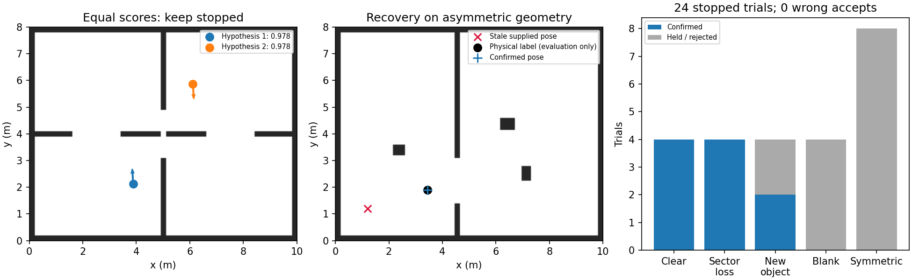

# 剩余问题、设备限制与本轮修复

当前结论：尚未达到整机训练算力或内存上限。主要阻碍包含未完成的算法机制、真实输入/地图一致性，以及在弱几何下缺少可辨识信息。局部代码确有耗时瓶颈，本轮已在同一录包中测出批量评分的改善；不能把它等同于实车定位已经解决。

## 设备与资源

| 项目 | 本机实测 | 判断 |
|---|---|---|
| CPU | Intel(R) Xeon(R) CPU E5-2696 v3 @ 2.30GHz，36 逻辑核 | 当前实验平均只用约 0.35 核，未耗尽整机算力 |
| 内存 | 总计 62.6 GiB，可用 53.4 GiB | 本轮资源充足 |
| GPU | NVIDIA GeForce RTX 3060 Laptop GPU，6 GiB；PyTorch CUDA=True | CUDA 可用；此前训练代码显式使用 CPU |
| 磁盘 | 可用 6.07 GiB | 不宜无上限保存训练/视频产物 |

最新恢复训练加载器在 `train_localization_recovery.py` 明确使用 `device='cpu'`，并按此前要求限为平均约 0.4 核、单线程。因此耗时长不代表 CUDA 失效。MuJoCo、地图搜索、轨迹和安全检查不会因只把 actor 放进 GPU 而自动加速。此判断来自当前代码和设备实测，没有对 Orin 作推测性性能承诺。

## 本轮完成的代码

- `training/neural_navigation/global_relocalizer.py`：已有地图的离散全图搜索、多个空间候选、占据/未知语义、完整矩形车体与 4cm 余量检查、地图射线矛盾检查。没有输入物理位姿真值。
- 增量搜索有 CPU/节点预算；不完整的搜索不能授权位姿重置。新版本批量评分 64 个分支，地图尺度、2° 角度格、接受/停车门槛和资源预算保持一致。
- `StoppedPoseRecovery` 要求停车、连续至少 3 个新时间戳并跨越至少 0.4s 确认。扫描过期、运动、歧义或确认不一致时继续保持零速度要求。
- `apply_confirmed_pose` 提供明确的运行时重置接口，清除旧位姿的定位/扫描历史、路由缓存、动态记忆与保护预测，保留位置和方向目标，重置帧仍为零命令。外层任务截止时间与 TF 一致性由调用方保留。
- 停车采样的 MuJoCo 测试移除了雷达排除的显示网格；8 组完整/精简模型射线对照一致，24 组重复采样最大差为 0。峰值 RSS 从 1981.1 MiB 降到 95.1 MiB。这仅是传感器测试的降耗，不是完整动力学训练降耗比例。

新模块是显式调用的实验候选，没有自动接入部署入口或自动丢失检测，没有替换原模型，没有新增 PPO 步数，也不是训练出了新的神经定位器。

## 仿真结果与拒绝情况

28 组历史实际 MuJoCo 扫描中，10 组产生定位候选，错误候选为 0。其余因歧义、回波不足拒绝；最终批量版这 28 组均未因预算耗尽而停止。单帧候选不算恢复成功。

24 组停车采样由 6 个位置 × 4 种条件构成，使用不同噪声种子，复用已经开发过的地图和起点；不是 24 个全新位置，也不称为未见地图泛化：

| 类别 | 确认恢复 | 保持等待 | 解释 |
|---|---:|---:|---|
| 非对称地图，正常扫描 | 4/4 | 0 | 能从数米偏离的旧位置恢复 |
| 非对称地图，随机缺失＋局部扇区缺失 | 4/4 | 0 | 输入噪声 1cm、随机缺失 8% |
| 非对称地图，新增未入图实体 | 2/4 | 2 | 一例歧义，一例新帧确认不一致；仍未完全解决 |
| 非对称地图，整帧缺失 | 0/4 | 4 | 应等待，不是强行猜测位置 |
| 对称地图，含正常/缺失/新障碍/空帧 | 0/8 | 8 | 维持拒绝，不能凭单雷达消除对称位置歧义 |

最终确认 10/24，错误确认 0；已确认案例最大位置误差 1.36cm、最大航向误差 0.239°。这是小规模仿真精度，不能解释成实车厘米级或重新定位后的完整导航验收。

搜索 CPU 时间 P50/P95/最大为 0.430/0.547/1.043s；全套实验平均 0.35 核，峰值 RSS 96.1MiB。搜索用于停车期间的工作，不放进每帧跟踪控制路径；增量切片也不是硬实时调度保证。



左图两个候选得分相同；中图展示旧位置与重新定位；右图的等待有一部分是信息不足时必须保留的行为。

## 真实 record.zip 的结果：尚未通过

对 map_01 录包的相同 6 段、相同起始扫描进行批量评分前后对照：搜索总 CPU 耗时减少 43.6%，原来 4 段预算耗尽，批量后全部完成。

| 任务段 | 原 CPU/s | 批量 CPU/s | 搜索 | 最终拒绝原因 |
|---|---:|---:|---|---|
| 1 | 2.08 | 1.02 | 完成 | free_space_contradiction |
| 7 | 4.00 | 2.02 | 完成 | no_supported_pose |
| 10 | 4.00 | 2.56 | 完成 | no_supported_pose |
| 13 | 4.00 | 2.28 | 完成 | no_supported_pose |
| 19 | 4.00 | 2.40 | 完成 | no_supported_pose |
| 22 | 1.87 | 0.98 | 完成 | no_supported_pose |

**6 段均未完成可接受的恢复。** 部分候选虽有较高端点匹配率，但有限回波穿过地图占据区，或后续新帧不确认，因而拒绝。`no_supported_pose` 表示这些接受条件下没有支持充分的候选，不是证明地图上根本不存在正确位置。没有通过放松矛盾检查或删墙制造“成功”。

现在可以区分：这 6 段的预算耗尽已改善，剩下的主要拒绝来自地图/扫描一致性与确认条件。原因尚不能唯一归因于噪点、外参、时序、地图变化或错误候选，必须用参考位姿进一步区分；不能以搜索完成宣称定位正确。

录包不含独立绝对位姿真值，`2D Pose` 人工重置与旧模型输出均不是真值。本回放也无法改变当时车的运动，不能算新的实车闭环试验。核心时间为运行相对时间，ROS scan/decision 为绝对时间；脚本在各自时钟域计算年龄，避免混用。

## 仍未解决的问题及下一步顺序

| 优先级 | 问题与证据 | 下一步 | 何时继续训练 |
|---|---|---|---|
| 1 | 实车底盘仍选择 command 里程计；录包已有新鲜的轮反馈与 IMU | 校验轮序、方向、比例与时戳，用已记录轮反馈＋陀螺仪做并行里程计对照；测实际直行/转弯，不把指令积分当实走距离 | 有参考位姿并确认输入正确后，才用测得误差随机化训练 |
| 2 | 真实地图/扫描矛盾，新的全图恢复 0/6 | 在有参考位置、朝向的静止点审计原始扫描外参、已知墙面和地图噪点；新增障碍只从静态匹配证据中隔离，避障仍看原始扫描 | 确认是定位泛化不足后再训练定位器；恢复 PPO 不能更新冻结定位器 |
| 3 | 动态横穿仍碰撞，历史固定 12 例为 11 到达/1 碰撞；2k 试训未改善 | 对齐 actor 与动作限制的传感器预测来源，保留未知/测量年龄、停车风险，先做预测误差与有效动作诊断 | 新观测合同及固定场景安全检查通过后训练；原 2k 只有 377 步可更新、1063 步只有停止 |
| 4 | 未知环境在线 SLAM 历史 12 例仅 5 安全到达，并有假到达 | 单独验证局部里程计、子图匹配与真实回环约束，保持感知地图和碰撞几何分离 | 不能因已知地图恢复试验通过就宣布 SLAM 或相关 PPO 可用 |
| 5 | 历史整条控制链 P95 90～176.8ms、最大 238ms | 分项优化路由/预测/可行动作检查，按 0.2s 控制周期处理超时；Orin 上实测 P95/P99/最大值 | 不把本机定位几毫秒或 CUDA 可用当作 Orin 整机验收 |

这些路线仍有软件改善空间，不支持现在先换显卡或盲目增加 PPO。若进入长期完全无几何特征或严格对称区域，单雷达＋有漂移的里程计无法保证绝对位置唯一；需要恢复可见特征、可靠初值或额外独立观测。更多训练和算力不能凭空增加这部分信息。

车宽约 32.95cm、4cm 保护余量时，通道只比车宽多 10cm，理想零偏航下单侧只剩 1cm 给定位、地图和控制误差；2° 偏航后约剩 3.2mm。这是窄道误差预算的限制，不是 GPU 限制。多 15cm 时余量明显宽松。不能用平均/P95 定位误差代替窄道的最坏情况验证，也不能靠缩小车体来提高成绩。

## 复现与产物

在此工作树根目录，使用项目虚拟环境并设置 `PYTHONPATH=training:.`、`OPENBLAS_NUM_THREADS=1 OMP_NUM_THREADS=1 MKL_NUM_THREADS=1`：

```sh
python -m unittest -v training.test_global_relocalizer training.test_fast_static_localizer
python training/experiments/benchmark_global_relocalization.py --cache reports/localization_mapping_20261015/amcl_comparison/sensor_cache --output /tmp/recovery-new-run --cpu-cores 0.35
python training/experiments/replay_recorded_relocalization.py --record /home/ubuntu/rl_learn/record_analysis_20261014/raw/20261014_193644_map_01test_953a9959 --hardware models/quality_recovery_20261014/portable/hardware.json --output /tmp/real-recovery-new-run --cpu-cores 0.35
```

26 项实现检查通过，包含穷举格点评分对照、边界上界、对称/空帧拒绝、过期/运动拒绝、方向目标与运行时历史重置，以及旧定位器回归。实现检查不是导航成功次数。完整模型与原部署入口均保留。

[设备快照](HARDWARE.json) · [汇总](SUMMARY.json) · [实现检查](CHECKS.json) · [最终仿真数据](relocalization_batched/RESULTS.json) · [真实录包对照](real_record_batched/RESULTS.json) · [完整/精简射线检查](SENSOR_MODEL_PARITY.json) · [重复采样一致性](COMPACT_REPLAY_PARITY.json)

## 算法参考与适用范围

搜索采用预计算局部最大值上界、分支剪枝、精配准的通用相关匹配思路，参考 [Cartographer 2D FastCorrelativeScanMatcher 源码](https://github.com/cartographer-project/cartographer/blob/master/cartographer/mapping/internal/2d/scan_matching/fast_correlative_scan_matcher_2d.cc) 和 [官方算法说明](https://google-cartographer-ros.readthedocs.io/en/latest/algo_walkthrough.html)。此处是独立的简化实验实现，不是移植完整 Cartographer，不含其位姿图或回环后端，也不是已证明比 AMCL 更精准或更省算力的通用替代品。
