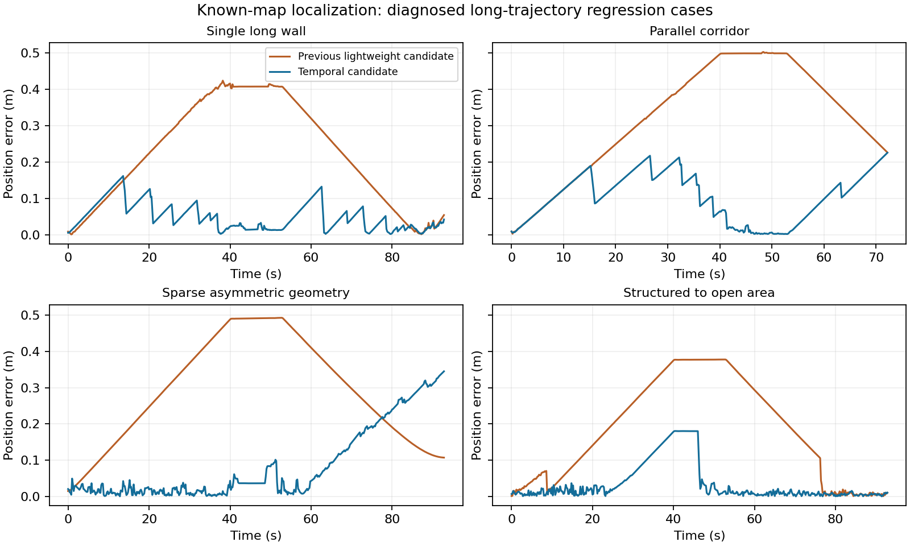

# 弱几何定位与策略适配结果（2026-10-15）

**定位回放改善不等于整机导航通过。新产物保持实验状态，原部署模型不替换。**

## 本次修改

1. 增加稀疏静态支持处理，避免固定 12 个点的门槛一律丢弃少量约束；保留几何矩阵的弱方向投影，信息不足的方向仍依赖里程计，不能凭空获得绝对位置。
2. 用当前时刻、前 0.2 s 和前 0.4 s 的静态点做短时融合，使用实测里程计转换到当前车体；历史点必须再次通过当前有限雷达回波及静态地图检查。未知、遮挡、整帧中断不恢复旧点。完整原扫描继续供避障使用。
3. 历史扫描的信息量取平均，不当成三份独立完整扫描；支持不足时清零可观测性诊断，避免显示上一帧的旧秩。协方差尚未经过实车误差标定。
4. 新增保守资源下的 PPO 适配入口。基础导航权重、路由器、定位算法及方向接近/停车 actor 冻结，只训练带传感器启用条件的恢复残差和 critic；原奖惩、12 个动作、车体和保护间距不变。
5. PPO 采样、旧概率、更新和导出使用相同的动作掩码与 logits。恢复区降低冻结先验的强度以支持探索，初始确定性动作顺序保持；运行时无教师控制器。
6. 导航记录补充真实输入里程计、反馈速度、路线和停止原因诊断；修复后续模型导出遗漏编译定位内核的问题。
7. 单独增加可选路线确认合同：旧路没有真实扫描/已知静态障碍阻挡，而仅运动预测导致候选路线大幅绕行或折返时，要求候选几何稳定 0.8 s。真实障碍、原始雷达、动作掩码与停车检查仍即时生效；默认旧模型不启用此合同。

## 定位对照

复用相同的 28 条 MuJoCo 扫描轨迹，其中 22 条归档验证轨迹用于下表按帧汇总。长轨迹已用于本轮故障诊断，属于回归验证；不可再次称为未见场景。人为里程计误差为压力条件，不是实车标定。

| 方法 | 验证帧位置误差 P95 | 定位平均 CPU/帧 |
|---|---:|---:|
| 旧 v5 | 43.4 cm | 2.93 ms |
| 上一轮轻量候选 | 48.5 cm | 1.46 ms |
| 本轮时序候选 | 18.5 cm | 2.93 ms |
| AMCL 300–1000 粒子 | 29.4 cm | 3.66 ms |
| AMCL 100–300 粒子＋运动触发 | 55.0 cm | 1.12 ms |

AMCL 使用已安装 Nav2 1.1.19 的原生算法库、全向运动模型和相同 60 束扫描，三个运动/重采样种子；CPU 不包含 ROS、IO 或限额等待。对照沿用上一轮固定输入成绩；不是穷尽 AMCL 调参，不涵盖其全局多假设定位能力，也不是 Orin 实测。低粒子配置的 CPU 开销仍更低。

| 长程回归场景 | 上轮候选 P95 | 本轮 P95 | AMCL 标准 P95 |
|---|---:|---:|---:|
| long_single_long_wall | 40.9 cm | 12.4 cm | 17.6 cm |
| long_parallel_corridor | 50.0 cm | 20.3 cm | 21.4 cm |
| long_sparse_asymmetric | 49.1 cm | 30.5 cm | 43.2 cm |
| long_feature_to_open | 37.7 cm | 18.0 cm | 38.9 cm |

长程稀疏场景的末段仍有漂移：最终位置误差 34.5 cm，错误高置信度帧占 18.3%。P95 改善不代表每个时刻都更好，也不满足实车精度验收。

Python/C++ 参考逐帧核对 3221 帧，最大位姿数值差 1.5e-14。原始逐帧结果与源码哈希保存于 `temporal_current_28`。

最初仅降低单帧门槛的候选在稀疏场景由 49.1 cm 退化到 58.2 cm，已拒绝；其闭环验证在两例后停止，不能算完整评估。未删除失败记录。

### 新的传感器随机种子

同一组几何、全新 MuJoCo 传感器随机种子（偏移 1000）。只检验相同几何下的重复稳定性，不能称为未知地图泛化。

| 场景 | 上轮 P95 | 本轮 P95 |
|---|---:|---:|
| long_single_long_wall | 45.5 cm | 21.5 cm |
| long_parallel_corridor | 45.9 cm | 16.6 cm |
| long_sparse_asymmetric | 46.6 cm | 18.8 cm |
| long_feature_to_open | 54.8 cm | 19.8 cm |

## 闭环导航与训练

相同 12 个历史开发任务，含原失败案例、动态反向/停走、原地转向、接近和方向停车。归档 v6 在这 12 例中为 11 成功、1 碰撞；历史参考非重新运行，不据此比较整机耗时。

| 阶段 | 成功 | 碰撞 | 超时 | 假到达 |
|---|---:|---:|---:|---:|
| before_policy_adaptation | 10/12 | 2 | 0 | 0 |
| ppo_2000（失败后停止，部分） | 0/1 | 1 | 0 | 0 |
| conditional_ppo_1000 | 10/12 | 2 | 0 | 0 |
| forecast_route_confirmation | 10/12 | 2 | 0 | 0 |

新定位器直接配旧策略时，原等待案例发生碰撞，即使定位 P95 约 3.6 mm，也不代表避障成功。恢复分支在该失败轨迹的 25/82 帧处于可训练范围，最后 10 帧不在该范围内；仅增加恢复训练不能保证修正全部危险动作。适配训练仅将这例作为既有训练难例复习，不把复习成功称为独立泛化。
该例在 9.6 s 和 14.0 s 附近分别出现 17→54、15→61 个路点的突然绕行，局部目标转到车后。新增路线确认实验保持原时序定位候选的 actor/router 权重不变，独立验证路线接受逻辑；不能将它算作 PPO 训练收益。旧 v6 同例重新复测 121 帧成功，用作因果参考，不提供运行时教师动作。

实际追加 PPO 2000 步；训练采样统计：`{"nonzero": 1467, "changed_nonzero": 0, "wait_with_alternative": 52, "only_stop": 481, "trainable_recovery": 224, "recorded_frames": 1159, "general_frames": 841, "episodes": 10, "success": 6, "collisions": 3}`。训练成功数不替代确定性闭环复测。

完整 PPO 网络、优化器随 zip 保存，另存随机数和课程状态；物理环境中途状态未序列化，不能宣称从回合中间精确续训。首次启动在执行任何训练前发现 Monitor 未透传 reward_scale，已修复，失败目录保留。

普通 2k 训练耗时 13.0 分钟，平均 0.35 个 CPU 核，峰值 RSS 2.39 GiB。后续对照分别限为 0.25 核，同时运行合计约半个核；未占用 GPU。资源限额是进程软平均限额，启动阶段有短暂波动。

## 实车记录复查

复查原始 1516 帧。没有独立绝对位姿真值，因此只检验地图纠偏是否被新增障碍拉动。

| 片段 | 原记录位移 | 本轮重放位移 | 输入里程计位移 |
|---|---:|---:|---:|
| mission 13 | 0.735 m | 0.055 m | 0.055 m |
| mission 19 | 1.347 m | 0.025 m | 0.025 m |

## 恢复分支损失归一化实验

普通 2k 追加训练首个已知难例仍碰撞，提前停止剩余回归以节省算力。接着从完整 2k checkpoint（含优化器）追加 1000 步，累计本轮追加 3000 步；这不是从零训练。

仅改变恢复 actor 损失的条件平均与优势归一化方式：只在固定传感器条件可训练且有合法运动动作的行上计算，critic 仍使用所有转移。采样动作、旧概率、掩码、PPO 比值、奖励和物理保护保持原规则。强制停车帧与被冻结的正常状态不再稀释恢复梯度。对应单元性质检查验证添加 100 个仅停车状态不会改变恢复梯度，以及全停车批次无 NaN。

条件实验采样统计：`{"nonzero": 872, "changed_nonzero": 0, "wait_with_alternative": 25, "only_stop": 103, "trainable_recovery": 145, "recorded_frames": 603, "general_frames": 397, "episodes": 6, "success": 4, "collisions": 2}`。观察优化量与最终导航成绩，不能以梯度变大认定能力改善。

## 产物与复现

- 定位候选：`models/localization_mapping_20261015/temporal_native_candidate/portable`。
- 2k PPO 与后续 1k 条件 PPO：`models/localization_mapping_20261015/temporal_recovery_ppo_2000`、`models/localization_mapping_20261015/temporal_conditional_ppo_1000`；包含完整训练 checkpoint 和独立 portable。
- 路线确认候选：`models/localization_mapping_20261015/temporal_route_candidate/portable`，与定位候选使用相同 actor/router，另有已哈希的路线接受合同。
- 验证入口：`training/experiments/benchmark_sparse_localization.py` 与 `evaluate_docking_navigation.py`；任务、参数、输入缓存、源码快照、逐帧轨迹、模型哈希均在各次评估目录内。
- 训练入口：`training/experiments/train_localization_recovery.py`；不在此入口中替换正式模型。
- 原生内核为当前 x86_64 编译，Jetson ARM 部署前必须重编译并重新核验；本轮未实测 Orin。

## 结论与能力边界

- 单元检查见 [TESTS.txt](TESTS.txt)；几何压力回放、真实记录回放和完整导航分开报告。
- 不确定性仍未标定，新增稀疏约束后存在错误高置信度样本，不能将标准差直接称为实车误差上界。
- 长程几何/初始化条件有限；实车绝对精度、全局重定位、长时无特征漂移、未知环境 SLAM 与回环均未因此通过。SLAM 后端本轮未更换。
- 保留全部失败及原部署包。即使局部定位指标在本测试集优于所测 AMCL 配置，也不能宣称整机或所有地图优于 AMCL。

后续先处理两件事：用真实误差校准弱几何下的不确定性，并核验由实时雷达跟踪得到的动态碰撞风险是否进入合法动作约束；再验证正常 actor 与新定位分布的适配。单纯继续同一种恢复分支 PPO，尚无证据能解决现有碰撞。路线确认单项实验不能替代动态安全预测。

参考：[Nav2 AMCL](https://docs.nav2.org/rolling/configuration_and_development/configuration_guide/others/configuring_amcl/)、[Zhang/Kaess 可观测退化分析](https://www.cs.cmu.edu/~kaess/pub/Zhang16icra.pdf)。短时静态支持与 PPO 适配为本项目实现，论文不构成本项目已通过验收的证据。
