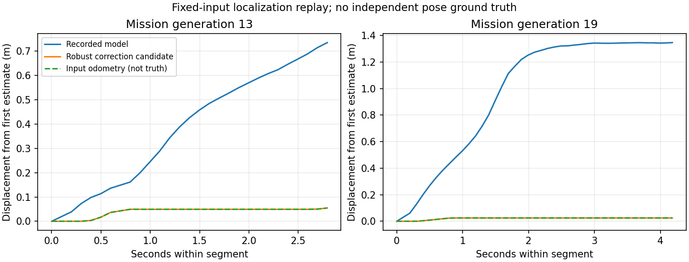

# 实车录制驱动的定位与目标朝向优化

本页保留上一轮定位 v1 与 250 步入口检查记录。后续 24 条物理定位对照、两轮 PPO 共 5k 步试训及 28 次闭环结果见 [后续报告](../real_adaptation_followup_20261014/REPORT.md)；方向停靠仍未通过，不能仅按本页回放改善判断部署有效。

本轮确认：已有 map_01，新增障碍物没有写入静态地图。改动保存在独立分支 `fix/real-odom-goal-yaw-20261014`，基于实车部署的 `models/best-2026-10-14`（57a5925）。原发布模型和原工作目录均保留。

## 结论与边界

原模型已有里程计传播，但之后接受了低地图一致性的匹配结果。新增回波、错误初始位姿和几何退化都可能产生这种结果；此次录制不能单独证明每个异常都是动态物体造成的。修改后，匹配需要通过静态支持、可观测方向、创新量与代价改善检查，否则继续使用里程计传播。

回放说明两段异常修正已受到抑制，**不代表已经证实定位绝对准确，也不代表实车导航成功**。录制没有独立参考位姿，地图与里程计可能同时有误。当前输入里程计还含指令积分；已有轮速反馈在记录中出现，但应先标定和对照，不能直接把命令积分称为轮子真实运动，也不能直接断言轮速或 EKF 谁最准。

## 完整录制对照

1,516 帧，按相同初始位姿、扫描与里程计输入回放，不重跑车辆动作。每次重新设置初始位姿或目标后单独重置；任务代次不是独立验收场景。

| 异常片段 | 原录制模型估计位移 | 新定位估计位移 | 同段输入里程计位移 |
|---|---:|---:|---:|
| 代次 13，27 帧 | 0.7353 m | 0.0548 m | 0.0548 m |
| 代次 19，41 帧 | 1.3466 m | 0.0248 m | 0.0248 m |

以上为片段末端相对首帧的平移距离，**不是定位误差**。两段新定位均没有施加地图修正，改善主要来自拒绝不可信匹配。



全录制中接受 203 次非零地图修正，109 次验证了不需要修正的静态匹配；834 帧静态支持不足，118 帧创新量超限，252 帧没有改善匹配。数据见 `replay.json`，轨迹数组见 `replay.npz`。定位器单独耗时 P95 约 3.45 ms、P99 约 3.57 ms，属于本机离线测量，**不包括路由、动作掩码、ROS 通信，也不能外推成 Orin Nano 端到端耗时**。

## 修改内容

### 定位融合

- 原始扫描完整供避障使用；只有定位评分临时筛除与里程计先验下静态地图不一致的回波。筛选不等于识别出了物体类别，贴近地图墙面的新增物体仍可能难以区分。
- 地图匹配需要足够的静态命中和支持比例。支持不足时保持里程计传播并增加不确定性。
- 用静态表面法向的位姿雅可比识别弱约束方向，避免单面墙把沿墙位置强行拉动。
- 平移和航向修正按真实时间限速，并要求改善静态匹配；不继续扩大搜索范围去为新增障碍物寻找一面墙。
- 已经吻合的静态回波可以验证零创新量，不必不断移动估计位置，也不会因此关闭质量特征中的位姿支持。
- 通过独立 `localization_contract.json` 启用，旧 bundle 默认仍走原定位器。阈值和不确定性均未完成实车标定。

这是偏保守的融合修复。没有独立真实位姿时，不能证明初始偏差和长距离漂移都已解决。理想静态回波专项检查能够减小一组小初始偏差；其他初始偏差仍可能因无改善而不被修正，后续需独立补训定位器，而不是只训练 actor。

### 目标方向与 PPO

- 新目标支持 `(x, y, yaw)`；方向表示到达后的期望朝向，不用于推断车辆当前姿态。
- 300 维质量观测扩为 303 维，追加方向误差的 sin、cos 和方向要求标志。旧 12 个动作与速度范围不变，仍无横移。
- 位置误差小于 0.12 m、朝向误差小于 0.15 rad（约 8.6°）、低速并稳定 0.4 s，才报告完整目标到达。这些是初始实验参数，需要按实车需求标定。
- 奖励保留真值测地进展、到达、碰撞与原有控制代价；新增近目标航向势函数，使用 PPO 同一折扣。仿真真值只进入奖励/验收，不进入策略观测。错误到达或碰撞不能用正向航向塑形抵消惩罚。
- 终止验证同时核对真实位置、真实朝向和实际速度；错误定位造成的假到达仍受罚。
- 加入约 35% 的原地对齐训练任务，其余保留原导航任务。远离目标的清晰正常导航状态有冻结参考策略的 KL 约束，目标附近允许学习新的停靠动作。KL 只保护已采样状态，不能代替正常导航回归测试。
- 迁移时只给第一层追加零初始化列，并迁移 Adam 状态，初始动作与旧模型一致。**迁移模型尚未学会目标方向**；更换输入维度必须同时更换训练、导出、运行时和 manifest。
- 旧 300 维 bundle 明确拒绝直接传入三元目标，避免把不支持的方向默默当作已满足。

### 时间与真实执行

- 新合同的三帧雷达历史按 0、0.2、0.4 s 取样，而非随每次函数调用拼接；5 Hz 和 10 Hz 调用的历史时间跨度一致。此项不等于已经消除了推理延迟或动作保持周期差异。
- ROS 适配器让父进程把实际发布命令传回 worker。超时结果未发布时，动作历史记录真实停车；策略候选动作与执行动作仍分别保留。
- 新 ROS 目标接口读取 quaternion 的 yaw。ROS 只负责传感器和消息接口，没有引入 Nav2、AMCL 或行为树。

## 验证与训练产物

13 项新功能检查、4 项既有质量特征/迁移检查、1 项独立 core 导入检查，共 18 项通过。覆盖未入图回波、转弯里程计坐标变换、时间缩放不确定性、单墙弱约束、静态修正、目标角度环绕、稳定等待、错误方向、旧模型兼容、Adam/动作迁移、掩码、导出、运行时合同、实际执行历史及历史帧时间一致性。另完成语法与差异检查。

最终单进程 250 步 PPO 入口检查位于：

`training/runs/goal_pose_entry_final_20261014/`

包含初始/更新 checkpoint、两套可加载 portable bundle、代码散列、配置、资源与进度记录。此实验单独测试目标方向训练入口，**未同时启用新定位门控**，便于分因素验证。250 步没有完成一个完整导航回合，不能报告成功率或朝向能力改善；原发布模型没有替换。早期入口检查目录保留为开发过程产物，不作为最终成绩。

配置为单环境、Torch/BLAS 单线程、低优先级、平均约 0.5 个 CPU 核的软限制。启动和导出没有硬配额限制；最终 250 步约 58.88 秒，峰值常驻内存约 1.72 GiB，见 `training_entry_progress.json`；这不是大规模训练或验收耗时预测。需要硬内存/CPU限制时应在确认 cgroup 生效的服务容器中运行，不能仅凭写了 CPUQuota 就认定限制已生效。

## 下一轮顺序与验收

| 顺序 | 实验 | 判断依据 |
|---|---|---|
| 1 | 固定录制输入继续验证新定位；补充正常闭环、转弯和稀疏场景参考位姿 | 无异常跳变；已知静态场景仍能修正误差；错误高置信度不增加 |
| 2 | 比较现有命令积分、已有轮速反馈与 IMU 融合，标定坐标、时间、比例和响应 | 用独立参考确认实际误差，不能仅选择看起来平滑的一路 |
| 3 | 目标方向单因素微调 2k–5k 步 | 独立对齐/停靠集有改善；旧正常路线无明显退化；不是按训练奖励选模型 |
| 4 | 有证据后把新定位与朝向模型组合，加入实车丢点/延迟条件 | 已有地图新增障碍、遮挡解除、窄道和完整目标姿态闭环测试 |
| 5 | 固定分类型测试 64–200 个任务及旧回归集，再做 ROS shadow 回放与真车低速验证 | 物理成功、碰撞、位置/朝向误差、假到达、干预与 P95/P99 耗时共同验收 |

最终测试集不能反复用于挑模型；另设开发/验证集。录制中未看到独立真值，需补数据才能评价定位绝对精度。不需要因为这些问题直接从零重训；匹配策略错误先修程序，定位器问题需补训定位器，方向停靠需训练 actor，路由器保持独立诊断。

新候选未通过实车部署验收。提供的 ROS 适配文件来自本次录制快照的修改版，未在真实 ROS 节点及底盘上运行；新未验收 goal-pose bundle 在适配器中只允许 shadow 模式。

## 运行方式

从本分支目录运行（使用已有虚拟环境）：

```sh
OPENBLAS_NUM_THREADS=1 OMP_NUM_THREADS=1 MKL_NUM_THREADS=1 PYTHONPATH=training \
  nice -n 19 /home/ubuntu/rl_learn/rl_learn_agv/.venv/bin/python \
  -m experiments.train_goal_pose_navigation \
  --checkpoint models/quality_recovery_20261014/policy_2000.zip \
  --output training/runs/goal_pose_trial_NEW --steps 2000 --stage static --cpu-cores .5
```

加入 `--odom-anchored` 可启用新定位合同，作为后续组合实验；先做单因素对照。目录必须未存在，步数为 250 的正整数倍。示例 2k 实验没有在本轮后台启动。ROS 适配接入说明见 `deployment/ros2_recording_adapter/README.md`。

## 工程依据

[Nav2 AMCL 文档](https://docs.nav2.org/rolling/configuration_and_development/configuration_guide/others/configuring_amcl/) 提供不一致光束跳过机制；本次采用静态支持筛选思路，并非直接复制 AMCL 粒子一致性判定或其默认数值。[robot_localization 文档](https://github.com/cra-ros-pkg/robot_localization/blob/rolling-devel/doc/state_estimation_nodes.rst) 区分连续短期 odom 与可能跳变的全局 map 修正，也说明里程计长期会漂移。[Nav2 SimpleGoalChecker](https://docs.nav2.org/jazzy/configuration_and_development/configuration_guide/core_servers/controller_server/controller_server_plugins/simple_goal_checker/) 分开检查位置和方向容差。上述工程支持设计思路，不能证明本项目已达到实车精度或最优路径。
