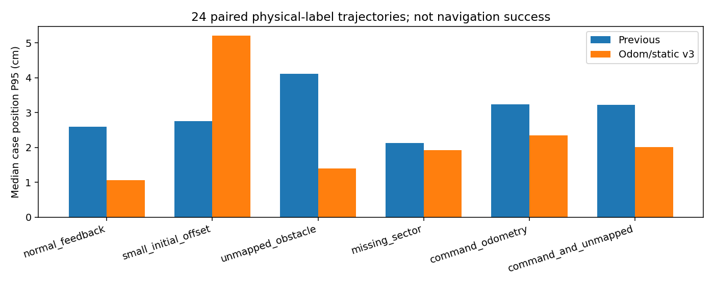
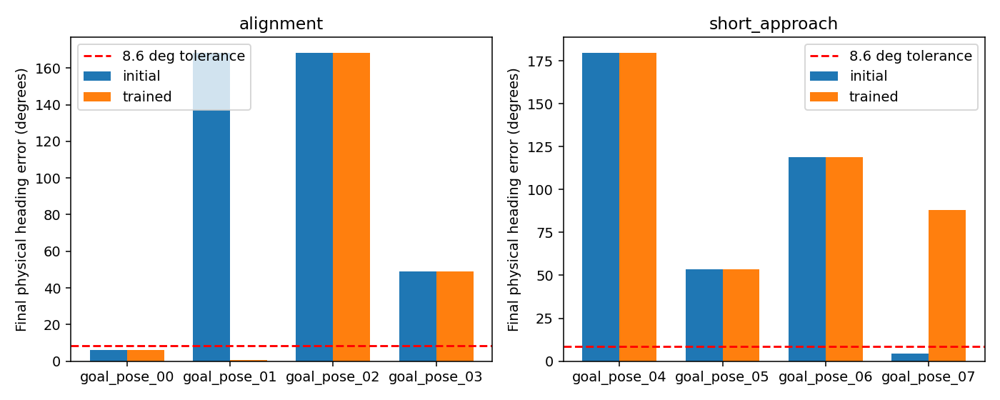

# 实车适配后续：定位物理对照与目标朝向 PPO

本轮继续修改和验证，保留原部署模型。**新产物未通过部署验收，不推荐替换实车模型。**

核心结果：新定位抑制了两段真实录制中的异常地图修正，独立物理对照部分条件改善、部分仍退化；方向 PPO 在 4 个刻意包含失败的旧回归任务中从 2/4 到 3/4，修复一个旧超时，但 8 个新增方向停靠任务仍为 0/8。因此不能将本轮称为方向训练有效或整体部署能力提升。

## 已完成

1. 为里程计锚定定位增加静态表面小范围鲁棒修正；按可观测方向投影，以米制尺度比较平移与航向约束。远距离静态命中允许小角度初始偏差，首次设置位姿后的短暂静止窗口允许较快、有界的纠偏。
2. 独立 MuJoCo 真值下完成 24 条配对传感器轨迹，覆盖正常、初始偏差、新增未入图障碍、连续扇区缺失、指令积分及组合条件。固定驾驶指令让两种定位器使用完全相同数据；策略没有参与这些轨迹，不能当导航成功率。
3. 完整回放真实录制 1,516 帧，重新检查之前两段虚假漂移。
4. 两个独立 PPO 微调实验实际追加总计 5,000 步：第一轮 2k 随机课程，第二轮从相同原模型重新迁移、3k 交替课程。**最终候选仅经过第二轮的 3,000 步微调，不是把两轮相加成一个 5k 模型。**
5. 固定 12 个开发任务、28 次运行：8 个位置＋方向任务配对初始/训练后模型；4 个旧位置任务分别运行旧发布模型、303 维迁移模型、训练后模型。旧任务包含原有两次失败与按固定顺序选取的两次成功。没有打开最终封存验收集。

## 定位结果

以下数值是各类 4 条轨迹各自 P95 的中位数，不是全样本总体 P95。平移单位厘米，航向单位度。碰撞真值、位姿真值独立于定位输入；新增物体在 8 条相应轨迹中均确实引入，物理几何保持不变。

| 条件 | 原定位平移 | v3 平移 | 原定位航向 | v3 航向 |
|---|---:|---:|---:|---:|
| normal_feedback | 2.60 | 1.06 | 0.53 | 0.19 |
| small_initial_offset | 2.75 | 5.21 | 0.59 | 1.19 |
| unmapped_obstacle | 4.12 | 1.40 | 0.72 | 0.28 |
| missing_sector | 2.13 | 1.92 | 0.96 | 0.18 |
| command_odometry | 3.23 | 2.35 | 0.86 | 0.46 |
| command_and_unmapped | 3.22 | 2.01 | 0.62 | 3.53 |



初始偏差的总体 P95 仍高于原定位，说明恢复有启动过渡。前 2 s 之后，四条轨迹 P95 为 0.95 cm, 1.34 cm, 0.62 cm, 0.54 cm；末端误差均不超过 0.53 cm。不能省略启动阶段来声称全部改善。

“指令积分＋未入图物体”的航向仍有退化。正常和新增障碍的平移改善，不能抵消这个缺陷。因此 v3 保持独立 opt-in 合同，没有合入本轮方向 PPO bundle。v1/v2 合同仍可加载，旧 bundle 默认行为保留。静态支持筛选不是物体识别，贴近墙面的新增物体仍可能混淆；不能保证完全无特征区域不漂移。

真实回放代次 13：原录制估计位移 0.7353 m，新定位 0.0548 m；代次 19：原 1.3466 m，新 0.0248 m。两段新结果等于输入里程计位移，没有施加地图修正。**这些是相对位移，不是定位误差，也不是实车导航成功。** 完整数据见 `record_replay_v3/replay.json`。

`record_motion_consistency.json` 使用接收时间轴对照实际发布命令、轮速反馈和 IMU，仅作为一致性诊断。在命令活跃段，命令与轮速的线速度差 P95 约 0.122 m/s、角速度差约 0.482 rad/s；轮速与 IMU 角速度差 P95 约 0.124 rad/s。这不是标定后的真实误差，时间、轴向与比例仍须核对，不能直接切换为“轮速一定更准确”。输入命令积分不能被称为真实轮子运动。

上述活跃段包含启停和转向切换。另取命令至少稳定 0.6 s 的 674 个活跃采样点，命令/轮速差 P95 降为约 0.041 m/s、0.0505 rad/s；稳定停车的 1,121 点轮速均为零，IMU 角速度绝对差 P95 约 0.00263 rad/s。差异主要集中在过渡段的迹象更明显，但尚未排除时间戳和反馈滤波影响，不能仅凭此确定底盘延迟。应优先拟合启停/转向响应与采集时序，而非把全程大差异当作固定比例误差。

## PPO 采样与实测闭环

两轮都保持 localizer/router 权重冻结，只有 303 维 actor/critic 更新，没有加入自动朝向控制器；运动仍由 12 动作强化学习策略选择，原车体和安全余量保留。安全动作掩码、旧概率和执行历史保持同一合同。目标位置误差 <0.12 m、航向 <0.15 rad、实际速度足够低并稳定 0.4 s，才算方向任务物理到达。

随机 2k 课程实际只有导航样本，未抽到原地对齐回合；训练奖励和优化器确实更新，但不足以证明新任务被训练。第二轮修正为从原地对齐开始交替导航，原地任务上限 100 步/20 s，导航上限仍 700 步/140 s。交替保证的是回合组成，**不等于训练步数各占一半**。

第二轮真实采样：`{"alignment": {"steps": 400, "wait_with_motion": 1, "only_stop": 0, "turns": 396, "heading_reward": -0.43161046912251066}, "navigation": {"steps": 2600, "wait_with_motion": 9, "only_stop": 0, "turns": 2098, "heading_reward": 27.0939796506106}}`。

| 任务类型 | 模型 | 物理成功 | 碰撞 | 超时 | 假到达 |
|---|---|---:|---:|---:|---:|
| position_regression | legacy | 2/4 | 1 | 1 | 0 |
| position_regression | initial | 2/4 | 1 | 1 | 0 |
| position_regression | trained | 3/4 | 1 | 0 | 0 |
| alignment | initial | 0/4 | 0 | 4 | 0 |
| alignment | trained | 0/4 | 0 | 4 | 0 |
| short_approach | initial | 0/4 | 0 | 4 | 0 |
| short_approach | trained | 0/4 | 0 | 4 | 0 |



表格按相同目标和相同物理验收比较；旧位置模型不与方向任务混算成功率。碰撞、物理保护、任务干预未出现、方向或稳定条件不满足均不能包装成成功。路径长度最短或全局最优没有在本轮得到证明。完整逐例错误、等待原因、轨迹散列和耗时见 `goal_pose_evaluation.json`；压缩逐步观测、动作掩码、实际命令及真值在 `training/runs/goal_pose_paired_evaluation_20261014`。

末端位置/航向误差取最后一个决策帧的物理位姿；碰撞可能发生于该帧之后执行的物理步。`index.html` 提供配对轨迹回放，仅显示静态地图与车体，没有保存动态物体动画；动态任务不能把它当完整场景录像。`heading_sensitivity.json` 另在完全相同的近目标观测/动作掩码下只替换方向输入，分析策略是否对目标方向敏感，不作为导航成功证据。

### 已定位的学习瓶颈

在相同的 128 个近目标观测/掩码上，把方向误差从 +90° 换到 −90°，训练后仅 2 个确定性动作改变，左右旋转符号改变为 0；动作分布平均总变差仅 0.0059。即使反事实地把方向误差设为零，平均停止概率仍只有 0.290%，确定性停止选择为 0。新方向列确实有更新，但对动作的影响还很弱。这个结果不是凭总步数推测，而是直接检查了同状态下目标输入对决策的影响。

旧模型的位置到达会由任务终止停车；新任务则必须学习转到要求方向并主动停稳，旧策略的近目标动作分布不自动具备这项能力。部分物理轨迹短时进入位置/方向容差仍持续旋转，无法获得停稳成功信号，详见 `settling_diagnosis.json`。不通过放宽速度条件、加入隐藏转向控制器或把单帧方向碰巧吻合算成功来提高指标。

下一轮应先做短停靠课程：包含已对齐/小角度误差、减速和连续保持停止，再逐步扩到 ±90°、180°及行驶后停靠；提高近目标新任务的探索与可更新样本占比，比较独立的近目标可训练策略分支，并保护基础导航。速度/停稳塑形应基于真实时间与物理速度，做单项对照。仅继续低探索的长导航微调，增加总步数可能仍采不到足够的连续停止成功样本。没有证据要求此时重训 router 或重做全部导航。

另一项旧任务 `independent_dynamic_013` 从原模型 140 s 超时、485 帧仅停止可选，改善为候选 55.6 s 安全到达、零帧仅停止可选；旧成功的两例保留，旧横穿碰撞一例仍存在。旧超时车走了 6.42 m 但未到，候选走 8.89 m 到达，**不能据此宣称路径更短**。这个 4 例集合刻意包含旧失败，不能外推为整体成功率。

18 项功能检查通过，另完成独立 core 导入、语法/差异检查。对 5,926 个真实闭环仿真决策帧，将 native PPO 和 portable 的动作/采样掩码逐帧核对，三种模型全部一致，见 `native_portable_trace_parity.json`。因此本次结果不是已观察到的导出动作错位导致；这仍不等于全部 PPO 实现和实车链路都无问题。

## 资源和产物

2k 耗时 7.58 分钟，峰值常驻内存 2.38 GiB；3k 耗时 10.83 分钟，峰值 2.45 GiB，平均 0.500 个 CPU 核。闭环对照耗时 21.06 分钟，峰值 2.01 GiB。单进程、单 Torch/BLAS 线程、nice 19；平均 CPU 配额为软限制，启动和单次导出不是硬限制。RSS 预算 4 GiB、可用磁盘低于 512 MiB 会停止。未清理或关闭用户应用。

可续训 checkpoint、初始/最终 portable、优化统计和配置分别在 `training/runs/goal_pose_balanced_3k_20261014` 与随机 2k 目录。源文件散列按各自实验记录，第一轮的源快照在改课程前封存。PPO checkpoint 保存网络和 Adam；这是新微调实验，未声称可逐位恢复环境和全部随机状态。端到端计时为本机离线传感器运行时，不是 Orin Nano 或真实 ROS 执行时序。

## 下一步优先级

1. 用本轮逐例对齐/停靠结果决定是否加训 actor：先看目标附近方向条件敏感性、是否绕圈和停稳，不能只因为总步数少就盲目扩训。保留原导航回归集，单独选模型。
2. 定位组合航向退化先做同轨迹反馈里程计对照，并标定现有轮速、IMU、时间戳和坐标；必要时补训定位器，继续只训 actor 不能修复冻结定位器。
3. 加入真实 6%–12% 无效束、固定扇区缺失、10 Hz 扫描与延迟条件；定位/路由/策略共享同一退化扫描，碰撞评估保留独立实体几何。
4. 完成更大、分类型验证后再组合新定位和方向模型，最后做 ROS shadow 和低速实车验收。真实录制仍缺独立位置参考，不虚报绝对定位精度。

## 依据与复现

[Cartographer 配置文档](https://google-cartographer.readthedocs.io/en/latest/configuration.html) 将占据空间残差与平移/旋转先验权重分开；本轮参考小范围静态匹配加先验约束的思路，没有运行 Cartographer、Ceres、Nav2 或行为树。这些公开方法支持机制设计，不是本项目效果证明。

```sh
OPENBLAS_NUM_THREADS=1 OMP_NUM_THREADS=1 MKL_NUM_THREADS=1 PYTHONPATH=training \
  nice -n 19 /home/ubuntu/rl_learn/rl_learn_agv/.venv/bin/python \
  -m experiments.train_goal_pose_navigation \
  --checkpoint models/quality_recovery_20261014/policy_2000.zip \
  --output training/runs/NEW_goal_pose_balanced --steps 3000 \
  --stage static --cpu-cores .5 --seed 114902 --balanced-alignment
```

定位配对脚本：`training/experiments/validate_odom_localization.py`；方向配对脚本：`training/experiments/evaluate_goal_pose_pilot.py`。实验目录必须新建。原发布 checkpoint SHA256 保持 `7a3dad60f76060daf6b311b4bc6db921d3925ef0cdcf11683fe99e282173de11`。本轮没有执行实车 ROS 控制或远程发布。
