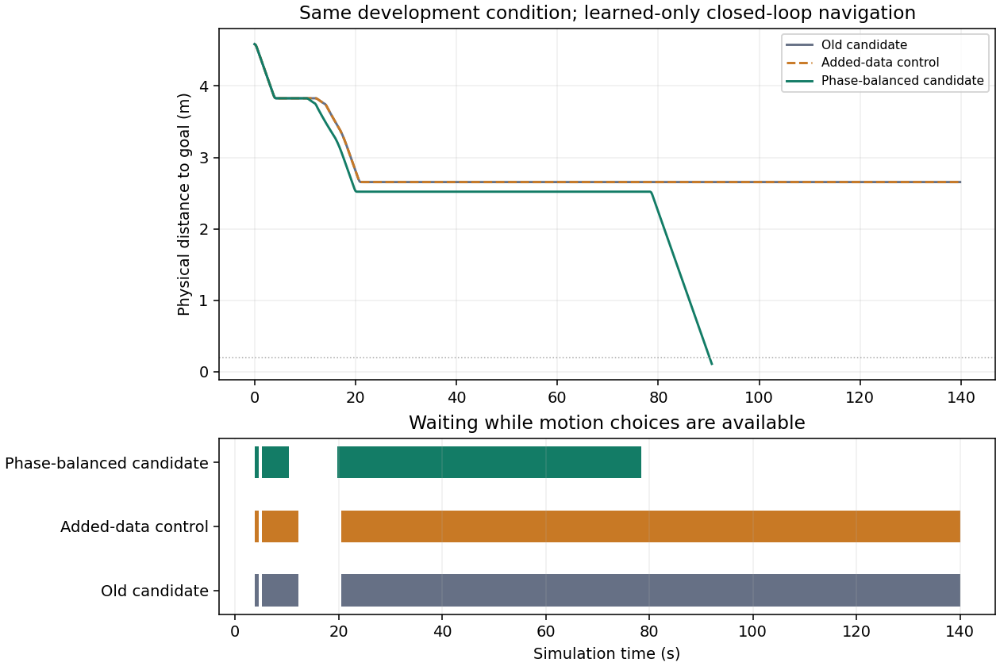

# 等待恢复阶段权重：有界闭环结果

2026-10-16 16:44:59（北京时间）完成。两组候选使用同一批 2,509 条安全来源，控制组保持原停车/运动损失分配，实验组提高等待后恢复运动的权重并对重复输入分配权重。阶段权重候选在三项模型闭环中均安全到达；对照候选在已知失败条件仍超时。

| 条件 | 旧 625 维候选 | 新增样本对照 | 阶段权重候选 |
|---|---|---|---|
| `long_risk_sensor_05_1`，已知等待失败 | 140 秒超时 | 140 秒超时 | **90.6 秒安全到达** |
| `early_yield_sensor_holdout_05_0`，保留旧成功 | 36.8 秒到达 | 本轮未运行 | **36.8 秒安全到达** |
| `release_phase_frozen_noise_05_2`，新噪声种子 | 未运行 | 未运行 | **33.0 秒安全到达** |

这是四次仿真、两个模型的结果，不能写成某个模型 4/4。阶段权重候选本轮为 **3/3 到达、0 碰撞、0 物理保护干预、0 假到达**，但只有一个新噪声条件；它不是充分的泛化或发布验收。新种子在两组拟合之后、闭环仿真之前冻结，仍是同一开发地图。

## 改善与仍存在的问题

已知失败条件中，有合法运动动作却等待从 **636 帧降到 323 帧**，最长连续等待从 **119.4 秒降到 58.6 秒**。对照组的观测、动作、执行、位姿、雷达和里程计与旧失败记录逐项完全一致，因此这次对照证据不支持“只增加相邻成功样本就能解决等待”。阶段分配与去重权重的组合产生了可测的恢复改善。

**58.6 秒等待仍然过长，目标没有全部解决。** 新候选的等待帧停车概率中位数仍约 0.999978；233 帧具有受支持的历史预测且接触分数全零，57 帧没有受支持的风险历史。这说明需要进一步检查风险解除后的决策和训练覆盖；零预测接触不等于已证明任何运动在反事实闭环中安全，不能直接把这些帧全部改标为前进。

旧成功条件的时间与路程均保持一致，分别为 36.8 秒、4.9477 米。该条件已进入本轮训练，只能作为保留检查。原四个“新噪声”条件已被诊断或用于来源，现属于开发集。

原始数据见 [RESULTS.json](RESULTS.json)、[四条完整传感器轨迹](physical/)、[离线逐帧审计](../release_phase_audit_20261016/RESULTS.json)及[可导出 SVG](../release_phase_audit_20261016/WAIT_COMPARISON.svg)。审计复现全部 1,505 帧的导出策略选择、动作掩码及非终点执行；没有新增物理交互。

## 模型、保护与资源

阶段权重候选位于 `models/stop_feedback_20261015/release_phase300_s231016/`，实际 **100 次监督更新，新增 PPO 0 步**。目录中的 300 是最大更新上限。检查点 SHA256：`66c3bd6b1875e4d038eeb8ac4726b7a4bf058846922cbbf84c7331f4381981f6`。优化器、随机状态、来源和 portable 导出均保存；导出前重现全部 2,509 个来源标签。

运行时仍是 625 维输入、12 个离散动作，最高前进 0.2 m/s、角速度绝对值 0.5 rad/s；定位器、路由器、基础 actor、方向停靠、真实车体及 4 cm 余量未改。本轮物理过程始终由导出模型选择动作，原保护层逐帧检查，没有运行教师、强制运动、清空盲区记忆或放宽保护。终点停车与策略提议的区别沿用原合同，未替换训练动作标签。

四次仿真串行完成，预算平均约 **0.35 核**、cgroup 上限单核 40%、内存硬上限 3 GiB；实测峰值约 **2,201 MiB**，用时约 **9 分 16 秒**。这是含 MuJoCo 的评估进程，不能代表板端部署内存。服务正常退出，当前无本轮后台训练或仿真。

422 个冻结输入的散列在结束时全部保持一致。协议、模型准入与源码快照见 [PLAN.json](PLAN.json)、[MODEL_ADMISSION.json](MODEL_ADMISSION.json)、[PROVENANCE.json](PROVENANCE.json)。本轮代码为 `training/experiments/evaluate_release_phase_pilot.py` 与 `audit_release_phase_pilot.py`。

## 下一步与交付边界

优先检查 19.8–78.4 秒这段长期等待在可观测条件、动作后果和来源覆盖上的差异，获得经过完整闭环验证的更早恢复证据，再做单项训练对照。并行保留常规导航、动态避障、旧恢复前缀、95/90/106 秒条件与方向停靠的完整回归要求，不能用这三个条件替代。

定位器没有在本轮更新，不能声称定位更精准。极窄 106 秒条件没有被本轮验证为修复。Orin Nano / 树莓派仍未实测，本轮主机仿真耗时不能当作板端实时性能。

旧实车 2k 模型、旧 625 维交付候选和 `realtest_20261016.tar.gz`、`realtest_edge_20261016.tar.gz` 均未替换。本研究候选尚未加入这些封存包，也未自动推送 GitHub `handoff3`；`deployment_approved=false`，完整目标继续保持未完成。
